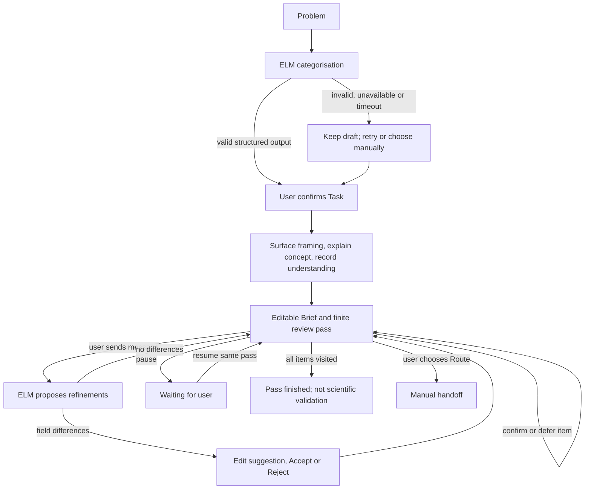

# Task classification and dedicated specifications

Implemented 9 September 2026. This is a pragmatic framing taxonomy, not a universal
ontology or a claim that Nirvana implements eight causal analysis engines.
Nirvana remains an upstream research-framing and review workflow.

## Primary task and task-specific Brief

Choose the requested research output, not keywords, domain, or proposed technique.
Retain the current five routes and add discovery, policy, counterfactual, and
ordinary prediction: eight substantive tasks plus an unclear/other fallback.

| Task | Requested output | Dedicated specs |
| --- | --- | --- |
| effect | Population intervention/exposure contrast | Purpose, intervention, comparator, outcome, population, time, assumptions |
| mediation | Effect through a proposed intermediate pathway | Purpose, exposure, mediator, outcome, population, target effect, ordering, uncertainty |
| shift | Robust prediction or generation across environments | Target/use, predictors/timing, training environment, deployment environment, suspected changes, predictor roles, deployment constraints, uncertainty |
| discovery | Candidate causal directions/structure | Purpose, measured variables/timing, observational and intervention data, prior ordering/structural constraints, latent-variable and measurement uncertainty |
| policy | Action/assignment rule under constraints | Decision/population, actions/current policy, objective/horizon, decision-time information, capacity/budget constraints, action-effect evidence, uncertainty |
| counterfactual | Same observed case under a hypothetical intervention | Factual case/purpose, observed state/outcome, intervention/contrast, counterfactual target, structural and case-preserving knowledge, uncertainty |
| prediction | Predict an unobserved outcome | Use/population, target/horizon, available inputs, training/evaluation data, success/validation plan, leakage and missingness uncertainty |
| descriptive | Summarise observed measures | Purpose, cohort, measure, denominator, strata, time window, data limitations |
| other | Goal unclear or outside these research tasks | Clarification and route only; do not invent a causal contrast |

These are editable minimum specifications, not mandatory complete intake forms.
Unknown values stay blank. Tags do not automatically add speculative fields.
The user confirms the task on Task, then proceeds to its dedicated Brief.
Manually switching tasks preserves an existing draft for that task in this session;
a task without a draft starts with blank specs, not fields borrowed from another task.
Every substantive task has an applicability summary and copyable tailored handoff.
Only shift points to DG Copilot, manually and subject to suitability review.

## Classification contract

The structured ELM result contains task, reason, optional context tags, fields and reply.
The server validates that all field IDs belong to that task, fills omitted specs
with empty strings, and rejects foreign field IDs.
The Task page shows the reason and tags, with the recommendation first.
This is a provisional recommendation, not a calibrated confidence score.

- Effect generalisation to another population remains effect, with transport.
  It is not predictive domain generalisation.
- Image synthesis across scanner changes is shift with generation; synthesis alone
  does not establish same-case counterfactual semantics.
- A specified mediator/pathway suggests mediation; learning unknown directions
  suggests discovery. A vague "why" may require clarification.
- Choosing whom to treat is policy; predicting risk or estimating an average
  treatment effect alone is not a policy-learning objective.
- Ordinary prediction and description need not invoke causal identification.
- Fairness is an optional tag only for an explicit equity/discrimination goal,
  not merely because age, sex, or subgroup counts are mentioned.
- Optional tags: generation, fairness, transport, longitudinal.
- For mixed goals, use the explicitly prioritised end goal. Explain the secondary
  goal or ambiguity and ask a useful clarification instead of inventing certainty.

## Literature-backed stories

Medical examples update: examples 2, 3, 5, 6 and 7 now use prostate MRI, chronic
pain, ADNI, STAR*D and brain MRI respectively. Examples 1, 4, 8 and custom 9 are
unchanged. Numbering still matches the eight tasks' default order.
Provider-independent tests pass for loading, source links, task-specific fields
and handoff routing; the replacement prompts have not yet been live-tested with ELM.

Examples 1–4 are now adapted from published studies, replacing the original
synthetic presets. Example 9 remains the user-provided CTPA problem, unchanged.
Examples 5–8 are newly written hypothetical prompts inspired by published work;
they are not quotations, replications, paper results, or verified project facts.
Only the question is loaded. The expected task is test metadata and is not sent
to ELM to determine the answer. A source link appears under the example picker
and is retained in the handoff provenance.

| Example | Literature basis | Adapted story |
| --- | --- | --- |
| 1 | [Baicker et al., NEJM (2013)](https://pubmed.ncbi.nlm.nih.gov/23635051/) | Medicaid coverage and depression screening about two years after Oregon's lottery. Effect framing must distinguish random selection to apply from actual coverage; no result or identification assumption is prefilled. |
| 2 | [Ouyang et al. (2023), IEEE Transactions on Medical Imaging](https://pubmed.ncbi.nlm.nih.gov/36417741/) | Cross-centre prostate MRI segmentation under acquisition changes. This is a robustness research question, not evidence of universal transfer or a validated DG Copilot workflow. |
| 3 | [Murillo et al. (2023), Pain](https://pubmed.ncbi.nlm.nih.gov/37289577/) | Pain education plus exercise versus standard physiotherapy: investigate fear of movement as a mediator of six-month disability. Randomisation of treatment does not remove mediator-outcome confounding. |
| 4 | [Hales et al., JAMA (2018)](https://jamanetwork.com/journals/jama/fullarticle/2676543) | The adult portion of an NHANES obesity-trends study motivates prevalence by sex, age and survey cycle. Describing these patterns does not estimate an intervention effect. |
| 5 | [Challenges and Opportunities with Causal Discovery Algorithms: Application to Alzheimer's Pathophysiology (2020), Scientific Reports](https://www.nature.com/articles/s41598-020-59669-x) | Investigate candidate causal directions among ADNI biomarkers and clinical measurements. The paper evaluates discovery algorithms; its reference graph and learned structures are not proof of a uniquely true graph. |
| 6 | [Pineau et al. (2007), Drug and Alcohol Dependence](https://pubmed.ncbi.nlm.nih.gov/17320311/) | Use STAR*D as a setting for sequential treatment-selection rules based on prior response. Frame a policy-learning study, not a personalised prescription. |
| 7 | [Pawlowski et al. (2020), NeurIPS](https://arxiv.org/abs/2006.06485) | Use the paper's brain MRI experiment to frame a same-subject hypothetical change in ventricle volume. The resulting image is model-dependent, not an observed alternative outcome. |
| 8 | [Rajkomar et al., npj Digital Medicine (2018)](https://www.nature.com/articles/s41746-018-0029-1) | EHR outcome prediction motivates a local readmission-prediction specification, without claiming a treatment effect or a new-hospital guarantee. |

The broader rationale and review are in nirvana-conclusion.md: description/
prediction/causal contrasts, causal discovery, policy learning and counterfactual
inference are complementary distinctions, not a direct copy of one taxonomy.

## Review behavior and tests

### In-progress workflow repair (11 September 2026)

The current canonical UI adds a Framing stage between task confirmation and Brief.
It surfaces extracted framing, an original concept explanation with textbook section
locators, and an unscored application question. Field help is authored in
`demo/guidance.js`; this is static guidance, not textbook retrieval or assessment.



State owners and executable guards:

| Node | Inputs / preconditions | Writes / effects | Verification and failure |
| --- | --- | --- | --- |
| Categorise | Nonempty problem; no request pending | One `/api/frame` request; provisional task/fields | Valid task and fields; 95-second client timeout; no automatic retry |
| Task | No categorisation pending | User-selected task; clears awaiting-review gate | `go` prevents later navigation before task confirmation |
| Framing | Confirmed substantive task | User's unverified reasoning note; `framingReviewed` | Later navigation returns here until Continue; no scored mastery claim |
| Review | Current task's field list | `briefCheck`: index, skipped count, paused flag | One pass visits at most the field count; confirm/defer increments index; resume does not reset it |
| Propose | No pending request or unresolved proposal | Proposed differences only | Send locked until review; errors retain current values and restore message |
| Decide | Current proposal | Accept writes edited text and invalidates confirmation; Reject keeps original | Typed changes do not touch Brief before Accept; history records exact accepted string |
| Exit | User chooses pause, defer or Route | No external tool execution | Pass finished means visited, not complete data, identified effects or scientific validity |

Automatic review begins on entering Brief but does not open the chat. The review
panel asks about one spec at a time, including populated specs. Users can refine
via chat, confirm clarity, leave it for later, pause/resume, or explicitly start
another finite pass. There is no unattended model-call loop. Manual worksheet
edits invalidate conversation and review state. State is browser-session-only;
refresh does not resume a durable checkpoint. See task-specs-qa.md for the final
provider-independent and targeted Chrome/ELM checks.

### Teaching provenance

The local source is the SDK's `assets/ElementsOfCausalInference_sections/markdowns`:
Peters, Janzing and Schoelkopf, *Elements of Causal Inference* (2017). The bridge
uses independently written explanations, not reproduced textbook passages or images.
Section locators in `guidance.js` identify foundations rather than implying that
the textbook contains these medical stories or the complete item-help checklist.
In particular, mediation, clinical policy framing, denominators and data-leakage
advice include Nirvana's methodological synthesis, not textbook quotations.

Checked conceptual anchors: 1.1-1.3 separate statistical learning and causal
models; 2.1 discusses independent mechanisms and explicitly notes violations;
3.1-3.3 define SCMs, interventions and case-conditioned counterfactuals; 5.2
discusses covariate shift; 6.6 distinguishes adjustment from conditioning;
7.1 and 9.4 discuss equivalence and hidden-variable discovery; 8.2 connects
actions and cumulative reward; 8.3 conditions transfer on invariant relationships.
None establishes that causality guarantees robustness for the user's CTPA study.
Book assets remain private and are not staged into the public demo.

### Downstream navigation (11 September 2026)

`demo/destinations.js` owns the compact Route directory. Each entry has a purpose,
required inputs, contributing Brief field IDs, a concrete next step, limitations
and an official documentation link. This is a curated navigation layer, not an
exhaustive software review, endorsement, installed dependency or executable adapter.

| Task | Candidate workspace and source | Important fit boundary |
| --- | --- | --- |
| Effect | [DAGitty](https://www.dagitty.net/), [DoWhy](https://www.pywhy.org/dowhy/v0.13/user_guide/causal_tasks/index.html) | A provisional graph and justified identification strategy precede estimation. |
| Shift | [DG Copilot repository](https://github.com/CHAI-UK/domain-generalization-copilot), [DomainBed](https://github.com/facebookresearch/DomainBed) | Copilot is a form/graph workflow; DomainBed is a code benchmark, not an image-synthesis adapter. |
| Mediation | [mediation R package](https://cran.r-project.org/web/packages/mediation/index.html) | Requires supported mediator/outcome models and identification assumptions. |
| Description | [survey R package](https://r-survey.r-forge.r-project.org/survey/) | Applicable to survey-design-aware summaries; not causal estimation. |
| Discovery | [causal-learn](https://causal-learn.readthedocs.io/en/latest/) | Requires prepared data and assumption-compatible algorithms; graphs remain uncertain. |
| Policy | [policytree](https://grf-labs.github.io/policytree/) | Single-decision feature/reward matrices; sequential STAR*D needs dynamic-regime expertise, not direct use of this entry. |
| Counterfactual | [DoWhy GCM](https://www.pywhy.org/dowhy/v0.13/user_guide/causal_tasks/what_if/counterfactuals.html), [DeepSCM](https://github.com/biomedia-mira/deepscm) | Structural models and case-level assumptions required; image plausibility is insufficient. |
| Prediction | [scikit-learn evaluation](https://scikit-learn.org/stable/model_selection.html) | Prepared features/labels, leakage-aware splits and intended-use metrics required. |

All tasks, including unclear requests, retain a manual methodologist / ChatGPT /
Claude fallback. No confidential data is sent by opening a tool link. Users must
decide what is appropriate to share with any recipient. Official sources were
checked on 11 September 2026; software installation and tool execution were not tested.

Follow-up chat proposes differences; no proposal edits the Brief automatically.
Accept writes that spec and invalidates review. Reject retains its exact value.
Pending/rejected edits are excluded from the handoff. Decisions are represented
as JSON-quoted values in history, and the follow-up prompt carries an exact
field-ID/value snapshot to prevent punctuation from being mistaken for an edit.
Conceptual replies should leave specs unchanged; only materially affected specs
should be proposed. Model compliance still needs empirical evaluation.

Provider-independent regression tests cover all eight literature examples through
generation, task confirmation, dedicated specs and copyable handoff; existing
tests cover Accept/Reject, copy isolation, stale requests and Markdown safety.
The backend checks every task's fields against the UI and validates empty and
foreign-key results.

Opt-in live smoke test (fictional questions; sends data to configured ELM):

```powershell
rtk conda run --no-capture-output -n educagent-sdk python tests/live_taxonomy.py --live
```

Ten cases cover the new tasks and classification boundaries. This is a small
smoke suite, not evidence of general classifier accuracy or scientific validity.

## Question-specific framing and worked examples (2026-09-11)

Generation now begins with `/api/classify` returning only task/reason. The user
can confirm Task while `/api/frame` asynchronously drafts for `selected_task`.
The status and retry are independent of navigation. Background results must not
change the selected task, overwrite manual edits, resurrect a reset question or
open chat. Worked specs are available as soon as their matching task is known.
The `other` classification skips background drafting entirely. The API accepts
concurrent requests on one shared model event loop; requests already sent to ELM
may finish after the browser aborts them, but their obsolete UI results are ignored.

The `other` exit uses Scope and next steps rather than a causal-applicability
claim. It offers a relevant domain expert or ChatGPT/Claude for clarification,
not a causal-tool directory. Copy referral note preserves the original question
and requests suitable expertise without forcing a causal framing. Outside scope
and insufficiently specified are both possible; this is not evidence that causal
methods cannot help. Changing back to a supported task restores its normal route.

- Field question marks use hover/focus tooltips, not expanding disclosures.
  Escape dismisses a focused tooltip; positioning is clamped to the viewport.
- `/api/frame` must return 2–4 concepts (`title`, `definition`, `relevance`).
  Concepts are selected from the actual question, facts and reasoning, displayed
  as H3 headings, and are provisional AI explanations, not verified quotations.
  General task foundations are explicitly labelled as fallback content.
- Reasoning is included in chat context and handoff. The explicit **Discuss this
  reasoning with Nirvana** button sends it to ELM and opens the chat; typing alone
  does not send it. Feedback is conversational, not scored. Brief edits remain
  Accept/Reject proposals.
- `demo/worked-examples.js` contains eight paper-anchored teaching specifications.
  Each records paper-reported anchors, authored teaching choices and unresolved
  decisions. Example 9 remains the user's custom CTPA question. For an unchanged
  worked question, AI independently classifies and explains concepts; when the
  returned task matches the teaching task, the authored specs populate the Brief
  rather than asking the model to reproduce them. On a different classification,
  AI fields are used. Editing the question exits worked-example mode. These are
  not eight independent tests of AI field extraction or replications of papers.
  Full provenance is available under Problem and travels in copied handoffs.
- Route recommendations are deterministic navigation rules: missing specs lead
  to LLM/methodologist clarification; sequential policies and complex mediation
  need specialist design review; image synthesis under shift needs a fit check
  before DG Copilot. Otherwise suggest the task's first curated workspace with
  inputs, limits and a reason. Entries in every field do not certify readiness.
  GPT/Claude are interchangeable preparation options here, not a performance
  ranking. Nirvana does not send to or execute any external tool automatically.
# Review focus and destination boundaries

UI copy is intentionally compact: repetitive AI disclaimers, workflow narration, and redundant sidebar/chat helper paragraphs are omitted. Keep actionable loading/error states, review decisions, paper provenance, concept definitions, and task/tool applicability information. This copy cleanup does not change agent instructions, generation, or Accept/Reject behavior.

Structured framing responses may include `review: {field_id, question}` (or null). The field must belong to the selected task. Chat history retains the question, while an active guided review displays it once in its current-spec panel. Pending diffs must all be accepted/rejected before changing focus. Resolved/deferred fields are retained for the pass; after a model-directed jump, remaining fields are still reviewed before completion. Review progress does not certify scientific validity.

The chat header and composer stay fixed; messages, proposed diffs, and guided review share one scrolling body. Accept/Reject changes only the named field and records a muted decision notice.

Route navigation recommends preparation with an appropriate specialist/analyst and optional general-purpose LLM, then conditionally lists task-relevant tools. Filled specs do not certify identification, model assumptions, data compatibility, or tool readiness. In particular: DG Copilot is not automatically appropriate for synthesis; DomainBed is not a ready-made medical imaging pipeline; individual image counterfactuals may require a bespoke SCM; survey software is conditional on sampling design; sequential policies need appropriate dynamic-treatment methods. Descriptive and ordinary prediction tasks do not automatically require causality. Unclear/out-of-scope tasks receive a clarification/referral note.
