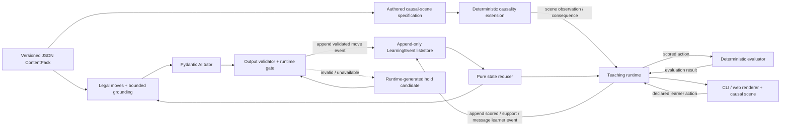

# EducAgent-SDK Implementation Plan

- **Status:** draft canonical technical sequence; current working tree, not yet published
- **Goal:** [`goal.md`](goal.md)
- **Progress:** [`roadmap.md`](roadmap.md)

## 1. How to use this document

Implement one numbered step at a time. The same IDs appear in `roadmap.md`.

For every step:

1. confirm its dependencies are complete in the roadmap;
2. implement only the declared scope;
3. run the step-specific checks and the complete provider-independent unit suite;
4. record evidence in the roadmap;
5. mark the step complete only when every exit condition is true.

Do not create destination files as empty placeholders. Add a module only when the active step gives it a concrete responsibility.

## 2. Current baseline

The project restarted from the documentation-only S0 checkpoint. S1 and S2 now provide:

- an installable Python `>=3.12` package;
- strict, frozen Pydantic content contracts;
- one authored Causality M0 JSON seed and a generated JSON Schema;
- reviewed claims, teaching resources, and release validation;
- provider-independent contract tests and constrained build instructions.

At the S3 boundary, concrete choice evidence, deterministic evaluation, and a pure teaching-move gate existed without session state, policy, events, renderer, CLI, or model dependency. The bootstrap stored earlier in Git history remains historical reference only and will not be copied back into the new design.

S5 is complete: one guarded Pydantic AI tutor now selects among scoped candidates over frozen replay-derived dependencies, while released resources produce learner-visible factual text. S6 is complete: the first vertical episode extends this kernel with committed classification evidence, a revision reference, deterministic consequence reflection, and an unseen transfer scenario; its ELM provider run is recorded in `docs/evidence/elm-qualification.json`. S14 adds a replay-validated bounded Socratic question and the Astryx client; `roadmap.md` remains the authority for live status.

These are historical implementation checkpoints. The legacy `--unguarded-tutor` switch now selects guided local free-text replies, not the original minimal vanilla baseline. It bypasses the guarded structured-proposal policy while retaining scored evaluation, scene actions, progression, and replay. The 2026-09-05 Portal repair retains the nine-concept backbone and scene, with revised full/delayed pack version `1.1.0` and separate version-specific default traces. Earlier packs/progress remain private. See `roadmap.md` for current evidence and `study-protocol.md` before making a study claim.

The guided free-text context is assembled from the current activity, phase-visible authored scene resources, `scene_text_projection`, the recorded prediction/reflection, and the current legal focus. Never dump the full scene or `TutorDeps` into this path: those contain future result records and assessment answers. Recent dialogue is restricted to the current attempt, and the latest learner message appears once. The plain-text reply uses a length validator/retry under the existing 1200-character event bound instead of truncating a sentence. Definitions and direct help remain available; early solution disclosure, invented scene mechanisms, grading, and claimed UI actions are disallowed by the teaching instructions. This is an instruction/context repair, not a semantic correctness validator or a newly qualified study arm.

## 3. Target component boundary



The core direction is:

```text
learner action
  -> declared causal-scene action, deterministic evaluation, or typed unscored support/message input
  -> append learner event
  -> replay-derived state
  -> legal candidates, bounded released grounding, and frozen scene snapshot
  -> Pydantic AI tutor reads declared scene facts and proposes one typed Socratic turn plus a next interaction focus
  -> output validator and runtime gate
  -> append validated move event
  -> replay-derived state
  -> learner-facing rendering
```

## 4. Contract rules that apply to every step

### 4.1 One source of truth

- Pydantic models own public Python and serialized contract structure.
- JSON owns authored content data.
- JSON Schema is generated from Pydantic.
- Do not keep an equivalent dataclass schema or hand-written JSON Schema beside the Pydantic models.

Internal session state may remain a dataclass when it is not a serialized public contract.

### 4.2 Authority

- Evaluator/domain extension: `accepted`, gaps, and deterministic or otherwise explicitly verified consequences.
- Tutor agent: interpret the learner turn into a non-authoritative hypothesis and propose one bounded Socratic turn; it never emits `accepted`.
- Pedagogy contract: legal teaching purposes, support/reveal limits, and expected evidence.
- Runtime: allowed moves, budgets, progression eligibility, cursor, events.
- Content/evaluator/runtime: factual, correctness, and progression authority.

### 4.3 Provider-independent safety kernel

Default unit tests must remain usable with no provider credentials or network access. Agent tests use Pydantic AI `TestModel` or `FunctionModel`; real-provider tests are an explicit integration/evaluation path. The first required source command appears in S1:

```powershell
$env:PYTHONPATH = "src"
python -m unittest discover -s tests -v
```

### 4.4 Progression invariant

The target contract is:

```python
advance_allowed_for_event_id = (
    response_event_id if evaluation.accepted and curriculum_requirements_met else None
)
advance_applied = (
    advance_allowed_for_event_id is not None
    and teaching_move_event.move.strategy == "advance"
    and teaching_move_event.evidence_event_ids == (advance_allowed_for_event_id,)
)
```

A policy can request `advance`; it cannot create progression permission or mutate the cursor. The permission is scoped to one current pending scored-response event and is cleared by unscored input or any non-advance move.

The local reliability repair also keeps `completion_evidence_event_id` after a
validated advance decision. This attempt-scoped reference is distinct from the
transient proposal permission above: optional dialogue, explanation and recovery
must not erase an already checked answer. A new scored judgment or attempt
transition invalidates it. `can_complete_attempt()` and replay still require
that recorded accepted evidence; free text cannot create it. Continuing after a
failed optional discussion first closes its pending request with a traceable
runtime-only recovery hold, preserving the checked answer without regrading.
The HTTP boundary distinguishes invalid requests/state conflicts from provider
or configuration failures and provides a request ID and recovery instruction.

### 4.5 Authoring retrieval boundary

A local source-locator index may map an M0 topic to candidate terms, sections, and pages. It is a derived, retrieval-only authoring artifact, not a ContentPack, public Pydantic contract, runtime truth source, CI dependency, or installed SDK dependency.

```text
topic ID -> candidate term -> section/page -> bounded source passage
  -> author/reviewer verification -> released Claim + SourceRef
```

The index narrows what an author reads; it cannot release a claim, prove a graph edge, or replace review. Runtime teaching remains grounded only in released resources, claims, and deterministic results.

### 4.6 Tutor-agent boundary

Use one named Pydantic AI `Agent` before considering a multi-agent design. Its dependencies are strict, frozen value snapshots containing only the replay-derived state and bounded context needed for the current turn:

```text
TutorDeps
  current SessionState projection
  current Evaluation, typed SupportRequest, or unscored LearnerMessage
  exact runtime-generated tutor-selectable candidate moves
  support and reveal budgets
  bounded released resources and claims
  bounded recent learner turns
  pack, evaluator, runtime, tutor, and prompt versions
```

`TutorDeps` never contains an event store, cursor, append callback, mutable `SessionState`, or provider object with write authority. Learner text and retrieved content are low-trust data fields, never dynamic system instructions. If tutor tools exist, they are read-only lookups over the already-bounded released grounding set.

Runtime candidate construction returns two explicit scopes: `tutor_selectable` and `runtime_only`. `hold` is always `runtime_only` and is never included in `TutorDeps`. The ordinary validator receives `selector_kind` and accepts a runtime-only candidate only for declared recovery, unsupported-request, timeout, provider-failure, or exhausted-retry paths; exact candidate membership alone is not sufficient.

The agent returns a strict `TutorTurnProposal`; plain-string output is not accepted. The proposal contains an exact tutor-selectable `candidate_id`, an optional typed misconception hypothesis with supporting event IDs, a bounded natural-language `tutor_reply`, and at most one bounded Socratic question on a legal question-oriented move. The reply receives no independent resource or claim IDs: the runtime derives and records its grounding closure from the candidate, and rejects replies on `advance` or `hold`. The reply cannot emit acceptance, mutate state, or advance. The runtime resolves the canonical `TeachingMove`, grounding closure, dialogue purpose, fixed framing, and expected-evidence predicates from the candidate; it never trusts agent-supplied resource, claim, framing, or progression-predicate IDs.

A hypothesis ID must belong to the current activity's released misconception set. Every supporting event must already exist, belong to the current session and attempt, precede the proposal, and be present in `TutorDeps`. A hypothesis may affect selection only among current legal candidates; it cannot change correctness, satisfied predicates, completion, or a permanent learner label.

S5 owns a small versioned headless `FramingCatalog`, a canonical `ResolvedTutorTurn`, and pure `compose_turn(resolved_turn)` contract. `ResolvedTutorTurn` carries the validated candidate/move, framing ID and catalog version, grounding closure, and expected evidence. The composer combines fixed neutral framing with released resources or a bounded persisted `tutor_reply`, then returns structured learner-visible text; S10 later presents that headless turn accessibly but does not own its wording. The reply is prompted only from frozen released grounding and retains the runtime-derived resource/claim closure for audit, while a later claim-support evaluator remains necessary before treating generated prose itself as reviewed subject truth.

Pydantic AI message history is bounded execution context. It never replaces the append-only learning trace or replay-derived learner state.

### 4.7 Interactive-object and Socratic-director boundary

The first interactive implementation is a causality-specific `CausalScene`,
not a generic SDK tool framework. Its authoring contract declares the scene
variables, allowed graph/model actions, released observational artefacts,
deterministic intervention outcomes, accessibility descriptions, and the
scored or transfer evidence the scene prepares. The content/domain extension
owns the pure transition from a declared learner action to its result. The
renderer only collects an accessible action and displays that result.

Every action must be an append-only, replayable event. An event records the
scene and attempt identifiers, the declared action, its bounded parameters,
the pre-action scene revision, and the deterministic result revision. The
runtime rejects actions outside the active scene's author-declared surface;
the evaluator/domain extension, never a click or the LLM, decides whether an
action produces accepted evidence.

The tutor remains one Pydantic AI agent with a strict `TutorTurnProposal`. For
an active `CausalScene`, the runtime derives and trace-records the sole legal
`interaction_focus_id` and dialogue job (`orient`, `elicit`, `interpret`, or
`consolidate`) from the frozen phase. The model selects a legal teaching
candidate and optional Socratic question but cannot steer scene navigation.
The runtime derives associated wording resources, hint level, and expected
evidence from that focus. The model may not supply arbitrary graph edges, simulation parameters,
tool names, code, or learner-visible causal facts.

The agent's only scene tools are read-only, bounded lookups over its frozen
dependencies: current scene snapshot, the last declared action/result, and
currently legal focus IDs. Register these as ordinary Pydantic AI tools or a
small coherent toolset only when S22 implements them. They are hot-path
context, so do not hide them behind capability loading. Future specialist
packages—guided notebook cells, an adjustment oracle, or estimation tools—are
separate deferred capabilities only when a concrete scene needs them. No tool
can obtain a session writer, arbitrary network access, or a live Python
kernel.

## 5. Step S0 — Documentation-only restart baseline

### Purpose

Create one explicit empty implementation checkpoint before writing the new public contract.

### Scope

- remove the legacy source, content, tests, CLI entry point, and obsolete background documents;
- retain only project metadata and the canonical design documents;
- make README capability and build statements truthful for an empty implementation;
- index the canonical documents in `AGENTS.md`;
- commit the reset as the point from which implementation restarts.

### Files

- `AGENTS.md`
- `README.md`
- `pyproject.toml`
- `docs/goal.md`
- `docs/implementation.md`
- `docs/roadmap.md`
- deliberate deletions under `content/`, `src/`, and `tests/`

### Checks

- no tracked Python, content, or test file remains;
- no package script points to a missing module;
- all local Markdown links resolve;
- README does not claim an implemented install, runtime, content pack, test suite, or CLI;
- `git diff --check` passes before the commit.

### Exit conditions

- the reset is one reviewed commit;
- a checkout of that commit is intentionally documentation-only;
- the commit contains no secret, local reference repository, generated cache, or stale capability claim;
- `git status --short` is empty immediately after the commit.

## 6. Step S1 — Authoritative Pydantic content contract

### Purpose

Create the first installable package and define one strict, readable, generatable content contract.

### Scope

Define structure before authored data. Add only the fields needed for one minimal Causality M0 seed activity; this step validates content but does not implement teaching behavior.

### Files

- add `src/educagent_sdk/__init__.py` and `src/educagent_sdk/contracts.py`;
- update `pyproject.toml` with Pydantic as a required runtime dependency;
- add `scripts/generate_schema.py` only because a committed generated artifact needs a reproducible command;
- add `schemas/content-pack-v1.schema.json`;
- add one minimal authored `content/causality_m0.json` seed;
- add focused content-contract tests under `tests/`;
- update README only with build and test commands that have passed.

### Contract

Use a shared strict base:

```python
class ContractModel(BaseModel):
    model_config = ConfigDict(extra="forbid", strict=True, frozen=True)
```

Define `Choice`, `Activity`, and `ContentPack` as Pydantic models. No duplicate dataclass or runtime representation is introduced.

Pack-local validators own:

- supported `schema_version`;
- non-empty stable IDs;
- unique concept, activity, option, hint, and explanation IDs;
- exactly one correct option per current choice activity;
- every activity concept resolves;
- every incorrect option has the required stable misconception/hint IDs and inline S1 hint text.

Generate JSON Schema with `ContentPack.model_json_schema()`. The generated file is committed for authoring tools but never edited by hand.

### Tests

- the minimal JSON seed loads through `model_validate_json()`;
- unknown fields fail;
- invalid types and accidental coercion fail at the trust boundary;
- all current uniqueness and concept-reference failures remain covered;
- schema generation is deterministic and the committed artifact is current;
- no network, model, or API key is required;
- the package builds and installs in an isolated environment;
- no CLI or learner-visible teaching behavior is claimed yet.

### Exit conditions

- Pydantic is the only authored structural schema;
- no duplicate manual structural schema exists;
- the generated JSON Schema matches the models;
- the seed pack and complete provider-independent suite pass;
- README build and test commands are verified.

## 7. Step S2 — Released claims and teaching resources

### Purpose

Move learner-visible teaching facts out of activity structure and make their provenance and release status explicit.

### Scope

Add the smallest registries needed by the current pack. Do not add RAG, ingestion, embeddings, or a generic content-management system.

### Contract additions

```text
Source
  source_id, citation, rights, review_status

SourceRef
  source_id, locator

DeterministicDerivation
  method_id, method_version

Claim
  claim_id, proposition, exactly one of source_refs or deterministic_derivation,
  release_status

TeachingResource
  resource_id, kind, text, claim_ids, release_status
```

Initial resource kinds are limited to those used immediately:

- `question`;
- `hint`;
- `explanation`;
- `consequence`.

Schema v2 replaces the S1 inline teaching fields in one direction:

```text
Activity.prompt                       -> Activity.question_resource_id
Activity.explanation_id/explanation   -> Activity.explanation_resource_id
Choice.hint_id/hint                    -> Choice.hint_resource_ids
every Choice                          -> Choice.consequence_resource_id
```

`hint_resource_ids` is an ordered tuple on each incorrect choice. A correct choice has no misconception or hint references; an incorrect choice has one stable `misconception_id` and at least one hint. `misconception_id` remains an opaque diagnostic ID owned by the future evaluator/rubric contract; S2 does not create a speculative misconception registry. Choice text remains activity stimulus, while correctness remains the deterministic choice rubric's responsibility.

`Claim.proposition` is the canonical reviewed subject statement. `TeachingResource.text` is learner-facing wording licensed by one or more claims; it is not a second correctness authority and an evaluator must never infer truth from that prose. Factual released resources reference released claims, and released claims reference reviewed sources or declare a deterministic derivation.

All S2 teaching resources require at least one claim ID because all four current resource kinds carry subject-facing content. A future genuinely non-factual accessibility or interface resource may justify relaxing that rule when it first exists.

A source-backed claim has at least one `SourceRef` with a non-empty page, section, paragraph, or equivalent author-declared stable locator; a citation alone is not provenance. A deterministically derived claim may omit an external locator only when it identifies a declared versioned deterministic method. S2 validates the identifier's shape, not the existence or result of a method that will first be implemented with the evaluator.

S2 also creates a released `consequence` resource for every current evaluator outcome, including accepted and rejected choices. This makes `Evaluation.consequence_resource_id` required rather than nullable in S3.

### Implementation rules

- replace schema v1 with schema v2 and migrate the single seed in place; do not add a one-use migration framework or support mixed inline/resource representations;
- keep `load_content_pack()` structural: strict fields and types, duplicate-key rejection, unique IDs, provenance shape, activity rules, and intrinsic concept references;
- keep authored data shapes in `contracts.py` and cross-registry release policy in one deep `release.py` operation, `validate_release(pack)`;
- make `validate_release()` raise one structured `ReleaseValidationError` for missing, draft, incompatible, or unreviewed references, and return a `ReleaseReport` that includes sorted unused resource IDs on success;
- locate every release issue with a JSON Pointer into the authored pack;
- store the current source citation, rights statement, review status, and stable locator in the pack; do not add repository, registry, or ingestion abstractions for one implementation.

The status, locator, and rights fields are auditable author/reviewer declarations, not cryptographic or legal proof. `validate_release()` checks their internal consistency and fails on an unreviewed declaration; it does not prove reviewer identity, source-file availability, or permission to distribute. External publication still needs a separate rights review. Add a release manifest/context only when that second real workflow exists.

### Tests

- unknown and duplicate source/claim/resource IDs fail;
- schema v1 and mixed inline/resource fields fail under schema v2;
- source-backed and deterministically derived provenance shapes validate, while missing or dual provenance fails;
- released resources cannot reference draft or missing claims;
- released activities cannot reference draft or missing resources;
- question, hint, explanation, and consequence references must have compatible resource kinds;
- unused resources are reported;
- ordered hints retain their authored order;
- every learner-visible factual resource resolves to provenance;
- every current activity reference resolves only to text authored in the pack; runtime output behavior begins in S3/S5.

### Exit conditions

- activity records no longer embed authoritative hint/explanation prose;
- every factual response shown by the current pack is traceable by resource and claim ID;
- the pack release validator reports no unresolved released references.

## 8. Step S3 — Typed learner evidence, evaluation, and gated teaching move

### Purpose

Separate what the learner did, what it means, and what the tutor does next.

### Public contracts

```python
class ChoiceEvidence(ContractModel):
    activity_id: StableId
    option_id: StableId


class Evaluation(ContractModel):
    accepted: bool
    misconception_id: StableId | None
    consequence_resource_id: StableId


class TeachingMove(ContractModel):
    strategy: TeachingStrategy
    resource_id: StableId | None = None
```

`ChoiceEvidence` is concrete because only one response type exists. S6 introduces a discriminated learner-evidence union only when the second real response type exists. Evidence contains no `correct`, `accepted`, progression, consequence, resource, or free-prose field.

`Evaluation` contains semantic IDs, never learner-facing prose. An accepted choice has no misconception; a rejected choice has the authored misconception ID. The consequence resource resolves its released claims, so claim IDs are not duplicated in the evaluation.

`TeachingMove` initially supports only `elicit`, `socratic_hint`, and `advance`. A non-advance move requires one released resource ID; `advance` carries no resource, prose, claim, or next-activity ID. Runtime resolves claims from the released resource instead of copying them into the move.

Attempt identity, request idempotency, response ordinals, events, replay, policy provenance, model fallback, direct instruction, and support budgets belong to S4/S5 and are not prebuilt here. Presentation-number conversion belongs to the future renderer in S10; public evidence accepts stable IDs only.

### Runtime gate

The evaluator and gate remain separate pure operations:

```text
ChoiceEvidence
  -> deterministic Evaluation
  -> runtime-generated canonical TeachingMove tuple
  -> caller selects one candidate
  -> runtime rebuilds the tuple and validates exact membership
```

The current allowlist is deliberately small:

| Evidence and gate | Allowed move |
| --- | --- |
| rejected | first ordered `socratic_hint` for that exact option |
| accepted and curriculum requirements not met | `elicit` using the current question resource |
| accepted and curriculum requirements met | `advance` |

`curriculum_requirements_met` is a trusted runtime/curriculum input, never learner evidence or a field supplied by a move. S4 records that input with the scored response and binds progression permission to the resulting event ID; S7 will derive it from declared replay predicates. S3 keeps the invariant explicit without inventing that later state system:

```python
advance_allowed = evaluation.accepted and curriculum_requirements_met
advance_applied = move.strategy == "advance" and advance_allowed
```

### Implementation

- add `evaluation.py` for choice evidence, evaluation, and one deterministic evaluator;
- add `runtime.py` for canonical move generation and exact move validation;
- validate the complete pack release chain before evaluation or move generation;
- use stable `activity_id` and `option_id`, never array position;
- derive consequence, hint, question, and claim authority from the released pack;
- do not add an evaluator protocol, registry, runtime class, session state, policy, event, CLI, or model dependency.

### Tests

- malformed or injected evidence fails before evaluation;
- unknown activity and option IDs fail closed;
- option identity is independent of list order;
- evaluator output is stable and contains only the option's known semantic IDs;
- runtime does not accept a forged or stale evaluation because its public gate recomputes from evidence;
- rejected evidence cannot validate `advance`;
- accepted evidence validates `advance` only when curriculum requirements are met;
- unknown strategies, free prose, unrelated resources, and next-activity fields fail closed;
- all functions remain provider-independent and stateless.

### Exit conditions

- the schema-v2 seed evaluates provider-independently from stable activity and option IDs;
- correctness, move request, and progression permission are separate tested values;
- a move validates only when it exactly matches the runtime-generated allowlist;
- S3 adds no renderer, policy selection, attempt lifecycle, event, replay, or persistence behavior.

## 9. Step S4 — Agent-ready append-only events and replay

### Purpose

Make learner evidence, runtime decisions, validation, and session state auditable and recoverable before the first model call is introduced.

### Scope

Start with an in-memory event list and pure reducer. Do not introduce a store interface, database, or JSONL adapter until a second persistence implementation actually exists.

S4 also defines the minimal reducer-owned `SessionState` required by S5: current activity/phase, open attempt, response ordinal, last evaluation, support level, explicit support request, `advance_allowed_for_event_id`, and session status. S8 later adds a richer cross-activity learner profile; S5 does not depend on that later projection.

Extend `TeachingStrategy` with one runtime-owned `hold` move. It has no resource, changes no support state, and clears current progression permission. Full candidate construction includes `hold` with `selection_scope="runtime_only"`; the normal/tutor-selectable view excludes it. In S4, the deterministic baseline selector chooses the sole non-runtime candidate produced for a scored response and fails closed if that set is not singular. A typed support request invokes `hold` only with `selector_kind="unsupported_request"`. Recovery uses `selector_kind="recovery"`. Both paths validate the same exact runtime-only candidate through the ordinary move validator. S5 later adds `clarify` and `direct_instruction` when their real candidate builders and resources exist.

### Files

- add `src/educagent_sdk/events.py` for event contracts, commands, and reducer;
- update runtime to build and validate scoped canonical candidates;
- add `tests/test_events.py` when event tests no longer belong in runtime tests.

### Minimal reducer state

```text
SessionPhase = ready_for_activity | awaiting_response | awaiting_move | complete
SessionStatus = active | completed

SessionState
  session_id
  phase
  status
  current_activity_id?
  open_attempt_id?
  response_ordinal
  last_evaluation?
  support_level
  support_budget
  explicit_support_request?
  advance_allowed_for_event_id?
  pending_request_id?
```

An attempt starts with support level `0`. Its support budget is derived from the activity's ordered hint resources; it is not supplied by a model.

Minimum reducer transitions:

| Event | Required prior phase | Result |
| --- | --- | --- |
| `session_started` | no state | `active`, `ready_for_activity` |
| `attempt_started` | `ready_for_activity` | set activity/attempt, reset ordinal/support/request, enter `awaiting_response` |
| `support_requested` | `awaiting_response` | record explicit request, clear progression permission, enter `awaiting_move` |
| `response_recorded` | `awaiting_response` | increment ordinal, store evaluation, bind any progression permission to this event ID, enter `awaiting_move` |
| `teaching_move_selected` `socratic_hint`/`elicit`/`hold` | `awaiting_move` | update support only for a hint, clear the pending request and progression permission, enter `awaiting_response` |
| `teaching_move_selected` advance | `awaiting_move` with permission bound to its sole current scored evidence event | remain pending until the attempt closes |
| `attempt_closed` | open attempt | clear attempt/activity, enter `ready_for_activity` |
| `session_completed` | `ready_for_activity` | `completed`, `complete` |

Unknown or illegal transitions fail before appending an event.

### Event envelope

Every event contains a small common envelope:

```text
event_schema_version
event_id
sequence
event_type
session_id
pack_id + pack_version
payload
```

`attempt_id`, `activity_id`, and `request_id` are event-specific optional envelope fields with requiredness enforced by the event model:

| Event | Attempt/activity | Request ID |
| --- | --- | --- |
| `session_started` | absent | absent |
| `attempt_started` | required | absent |
| `support_requested` | required | required |
| `response_recorded` | required | required |
| `teaching_move_selected` | required | required |
| `attempt_closed` | required | optional transition request |
| `session_completed` | absent | optional transition request |

The common envelope does not use a vague combined version field in the implementation. Payloads are typed by event:

- `response_recorded` stores the complete learner evidence, deterministic evaluation, and `evaluator_version`;
- `support_requested` stores one typed support request—`clarification`, `explanation`, `accessibility`, or `do_not_know`—and never fabricates scored evidence;
- `teaching_move_selected` stores the unchanged validated `TeachingMove` plus the exact current pending `evidence_event_ids`, runtime-derived expected-evidence predicate IDs, `selector_kind`, `selector_version`, an optional decision-trace ID, and an optional fallback reason in its typed event payload; `advance` must reference exactly the scored event named by `advance_allowed_for_event_id`;
- `session_started` stores the pack and runtime contract versions;
- `attempt_started` freezes the activity, task, rubric, and their versions;
- `attempt_closed` stores `completed`, `abandoned`, or `interrupted` plus the evidence predicate IDs reached;
- `session_completed` stores the satisfied completion predicate IDs.

`event_schema_version` describes the event shape. Pack, evaluator, selector/tutor, prompt, and runtime versions describe the behavior that produced it. The prompt/model fields become populated when S5 introduces the tutor; S4 must not import Pydantic AI merely to reserve provenance. An idempotent request compares the canonical complete submitted command, whether learner evidence or a support request; the same `request_id` with different content is a conflict.

Initial event types:

- `session_started`;
- `attempt_started`;
- `support_requested`;
- `response_recorded`;
- `teaching_move_selected`;
- `attempt_closed`;
- `session_completed`.

### Write and recovery order

Session/activity lifecycle:

1. append `session_started`;
2. runtime deterministically selects the first required activity;
3. append `attempt_started` before presenting it;
4. on an explicit restart, append `attempt_closed(status="abandoned")`, then a new `attempt_started` for the frozen task;
5. an application interruption leaves the attempt open for resume; append `interrupted` only when an explicit close/recovery rule abandons it.

One learner turn:

1. validate the open attempt and complete request identity;
2. for a scored action, evaluate deterministically and append `response_recorded` before the tutor-agent decision;
3. for an explicit `clarification`, `explanation`, `accessibility`, or `do_not_know` request, append `support_requested` instead of pretending it is an incorrect answer;
4. replay the appended learner event and build scoped legal candidates; in S4, the baseline selector chooses the sole tutor-selectable candidate for a scored response, while a support request and every recovery path select the canonical runtime-only `hold` candidate with the matching `selector_kind`;
5. append exactly one `teaching_move_selected` for the request;
6. when the move is `advance`, append `attempt_closed(status="completed")`, then either open the runtime-selected next activity or append `session_completed`;
7. derive all state by reducing the resulting events.

The runtime, not the pedagogy policy, owns `next_required_activity(state, curriculum)`. The policy requests `advance` without naming a target. If the current activity still requires another response, `advance_allowed_for_event_id` is absent and `elicit` stays on the same activity. Once permission is bound to the current accepted scored event, only an `advance` move referencing exactly that event may close the attempt; the runtime then selects the next required activity from versioned curriculum order and predicates.

Pure replay never writes:

```python
replay(events) -> SessionState
recover_pending_turn(events, request_id) -> LearningEvent | None
```

If execution stops after either `response_recorded` or `support_requested`, `replay()` identifies that request as a pending turn. The separate recovery command rebuilds the full scoped candidates, selects the exact runtime-only `hold` candidate with `selector_kind="recovery"`, validates it through the ordinary gate, and appends at most one versioned `teaching_move_selected` event through the normal idempotent write path. `hold` preserves evidence, clears current progression permission, and changes no support state. Recovery never converts a support request into scored or rejected evidence and never appends a privileged move outside the scoped allowlist.

### Tests

- event-specific required/absent envelope fields validate;
- session/attempt lifecycle transitions follow the declared phase table;
- server sequence is monotonic;
- an identical request is idempotent;
- a reused request ID with different content conflicts;
- one response cannot receive two teaching moves;
- a pending scored response receives exactly one legal validated `hold` fallback on recovery, even when `advance` is also legal;
- a pending support request receives exactly one legal validated `hold` fallback without becoming rejected scored evidence;
- repeated recovery of either request type is idempotent;
- replay matches live cursor, attempts, evaluation, support, strategy, and completion;
- support, recovery, or any non-advance move clears stale progression permission, and `advance` requires the exact current accepted scored event;
- failed/incorrect evidence remains in history;
- typed support requests reach replay state without becoming rejected scored evidence;
- pack/evaluator/selector/runtime version changes are visible.

### Exit conditions

- events, not mutable summaries, are the session authority;
- the same versioned inputs replay to the same state;
- interruption cannot erase evidence or become completion;
- JSONL and database work remain deferred.

## 10. Step S5 — Guarded Pydantic AI Socratic tutor

### Purpose

Make one Pydantic AI agent the primary tutor while keeping factual, reveal, support, and progression boundaries executable and visible.

### Agent contract

Create one named `Agent` with `deps_type=TutorDeps` and `output_type=TutorTurnProposal`. Do not add a model-adapter interface, agent registry, or multi-agent orchestration.

S5 adds a bounded `LearnerMessage` input and `learner_message_recorded` event for natural-language dialogue. The message is unscored low-trust data: it cannot create an `Evaluation`, satisfy a curriculum predicate, or advance. Its event requires the current attempt, activity, and request IDs; stores bounded non-empty text; follows the same idempotency/conflict rules as other learner inputs; and transitions `awaiting_response -> awaiting_move` while setting the pending request and clearing progression permission.

S5 extends recovery so an interruption after `learner_message_recorded` is handled exactly like other pending learner inputs: rebuild the full scoped candidate set, validate one runtime-only `hold` with `selector_kind="recovery"`, and append it at most once. A subsequent non-advance move clears the pending message and returns to `awaiting_response`. S5 also adds `clarify` and `direct_instruction` strategies, their released-resource candidate builders, and reducer state for requiring a new learner action after direct teaching.

`TutorDeps` carries the bounded context declared in section 4.6. `TutorTurnProposal` contains:

```text
candidate_id                  exact runtime-generated candidate ID
socratic_question?            one bounded legal question, persisted with the move
misconception_hypothesis_id?  current activity's released misconception ID
supporting_event_ids?         prior in-scope events present in TutorDeps
```

The runtime resolves the selected canonical move, grounding resources/claims, dialogue purpose, fixed framing, and expected-evidence predicates from `candidate_id`. S5's pure headless turn composer combines released teaching resources with that framing; S10 later handles accessible UI presentation. S14 persists one validated Socratic question when allowed. The system records the compact proposal and validation facts, not private chain-of-thought or arbitrary generated teaching prose.

S5 extends `teaching_move_selected` with stable replay references: `candidate_id`, `framing_catalog_version`, derived `framing_id`, and the derived grounding resource/claim IDs. Together with the existing pack version, canonical move, evidence IDs, and expected-evidence IDs, these fields reconstruct the same `ResolvedTutorTurn` without calling the model again.

Because S4 had only in-memory events and no released persistence format, S5 replaces the unreleased event schema `1.0` with `2.0` rather than maintaining two event payload shapes. Event schema `2.0` makes candidate, framing, grounding, and hypothesis provenance required.

### Guardrail order

For every scored response, typed support request, or unscored learner message:

1. record the learner event before calling the model;
2. replay current state and build exact legal candidates;
3. assemble frozen snapshots of only the released resources/claims and recent turns needed for this decision;
4. run the tutor with a bounded timeout and structured-output retry budget;
5. use an output validator to require exact tutor-selectable candidate membership and the section 4.6 hypothesis rules;
6. rerun runtime support, reveal, retry, and progression gates;
7. append the validated move and decision provenance;
8. on timeout, provider error, exhausted retry, or invalid output, rebuild the full scoped set, validate the canonical runtime-only `hold` with the matching fallback `selector_kind`, and append it idempotently.

The agent may interpret a `LearnerMessage` into the validated tentative hypothesis declared in section 4.6. That hypothesis can affect which already-legal question or hint is selected, but it is not correctness evidence and cannot become a permanent learner label. Only an evaluator/domain extension can emit `Evaluation.accepted`; M0 learner messages remain unscored.

### Pedagogy rules

- one teaching purpose and at most one main question per turn;
- learner attempt before a hint, except explicit clarification, explanation, accessibility, or `do_not_know` requests;
- monotonic bounded support and no reveal during elicitation or hinting;
- a direct-teaching or worked-example escape when questioning stops being productive;
- a new learner action after direct teaching;
- `advance` is only a proposal that the runtime rechecks;
- every canonical candidate names the evidence it may use and the evidence the runtime expects next.

### Tests

- use Pydantic AI `TestModel` and `FunctionModel`; default tests forbid real provider requests;
- cover valid selection, malformed structured output, invented candidate IDs, forbidden unknown proposal fields, premature reveal, illegal advance, timeout, and provider error;
- prove bounded retry and exactly one idempotent, ordinary-gate-validated `hold` fallback;
- prove learner prompt injection cannot alter correctness, the candidate set, the gate, or state;
- prove frozen `TutorDeps` exposes no store, cursor, append callback, mutable session object, or write-capable tool;
- prove a tentative misconception hypothesis belongs to the current released set, traces only to prior same-session/attempt events in `TutorDeps`, and does not mutate correctness or learner status;
- prove `learner_message_recorded` is bounded, idempotent, unscored, clears stale progression permission, and receives exactly one validated `hold` after a crash-before-model-result;
- prove provider failure preserves the recorded response and cannot advance;
- prove the agent has no hidden learner-state store outside replay.

### Exit conditions

- one Pydantic AI tutor drives the current Socratic turn loop;
- every validated tutor turn is typed, grounded, runtime-validated, and replayable;
- the versioned headless turn composer resolves factual teaching and M0 framing to released resources and fixed templates, with only a bounded replay-validated Socratic question permitted from the model;
- model output cannot create correctness or progression eligibility.

## 11. Step S6 — One complete agentic causality episode

### Purpose

Prove that the guarded tutor and safety kernel teach one concept through dialogue, action, consequence, revision, and transfer rather than merely running nine choice questions.

### Slice

Build one end-to-end episode around the distinction between observation and intervention:

```text
inspect a scenario
  -> commit whether evidence is observational or interventional
  -> see a licensed deterministic consequence
  -> revise the same classification or explanation
  -> state what remains an assumption
  -> solve an unseen surface-transfer variant without a content hint
```

### Activity work

- add the second real response type and only then add an `activity_type` discriminator;
- extend the teaching-strategy enum with `reflect` or `practice_transfer` only when this episode first uses those moves;
- extend structured `LearnerEvidence` with `artifact_id` and optional `revises_evidence_event_id`; an original commitment creates the artifact ID, and a revision must name an earlier response event for the same session and artifact;
- prefer controlled classification or structured selection before free-text scoring;
- keep evaluation deterministic;
- reuse S5 `LearnerMessage` only as unscored dialogue context and a source for validated tentative hypotheses, while structured evidence remains separately scored;
- use a new software or neutral scenario for transfer.

### S6 contract decision

Two designs were considered:

1. add a separate episode state machine beside `LearningEvent`; or
2. extend the existing evidence/event/runtime path with one `classification` activity type and `ClassificationEvidence`.

S6 uses the second design. The existing append-only trace remains the only authority, and `ClassificationEvidence` adds an `artifact_id` plus an optional prior response-event reference. An original classification creates the artifact; later classifications in that attempt must cite an earlier classification for the same artifact. A `requires_revision` classification activity makes the first response select the released consequence through the new `reflect` move, so an initially correct label is still not sufficient to advance. The generic runtime, not the tutor, verifies the reference and only permits advance after an accepted revision.

The complete slice is authored in `content/causality_m0_episode.json` so the earlier S1–S5 seed remains a compact contract fixture. Its three activities are: clinic-data commitment and revision, an assumption judgment, and a software-transfer classification. Every question, hint, explanation, and consequence is a released resource grounded in released claims.

### Tests

- wrong evidence cannot emit completion;
- consequence differs from a generic right/wrong message;
- revision targets the same learner artifact/answer;
- invalid, cross-session, future, or different-artifact revision references fail;
- direct teaching still requires retry;
- transfer begins without a content hint;
- transfer uses a new surface story but the same evaluator meaning;
- `TestModel`/`FunctionModel` runs are exactly replayable; the separately invoked ELM live-provider run recorded in `docs/evidence/elm-qualification.json` also passes the same gates without bypassing the runtime.

### Exit conditions

- one learner can complete the episode through the guarded Pydantic AI tutor and headless runtime;
- one separately invoked real-provider smoke completes the episode without bypassing a gate; the recorded ELM run subsequently also qualifies under S9;
- every displayed fact and consequence resolves to released resources;
- events show the original commitment, support, revision, and transfer result;
- this episode becomes the contract test before expanding the curriculum.

## 12. Step S7 — Complete Causality M0 curriculum and status semantics

### Purpose

Expand only after the first episode proves the whole loop.

### Scope

- teach all nine declared M0 concepts;
- organize them into reviewed action-consequence-revision episodes;
- review candidate source anchors into located `SourceRef` records without making local source files a runtime or CI dependency;
- add W/D/M classification and a minimal first-model activity with provenance;
- provide misconception resources and transfer mapping for every concept;
- add a final unseen integrated transfer task;
- use distinct statuses: `completed`, `m1_ready`, and future `mastered`.

Curriculum content declares the activity IDs required for `completed` and the independent-transfer activity IDs required for `m1_ready`; the S4 reducer derives their canonical predicates from events. S7 must not add a separately mutable progress field. `mastered` remains an unavailable future status until delayed repeated-transfer evidence exists.

### Tests

- every concept has an objective, accepted evidence, evaluator, misconception resource, released claims, and transfer mapping;
- every scored activity has a deterministic evaluator;
- all episodes require action, consequence, and revision;
- transfer begins without content hints;
- one first-session completion cannot emit mastery;
- the guarded tutor completes the full curriculum while deterministic scoring and runtime gates remain intact.

### Exit conditions

- Causality M0 satisfies the content/domain portion of the M0 definition of done;
- completion and M1 readiness have explicit evidence requirements;
- mastery remains unavailable without delayed repeated transfer.

## 13. Step S8 — Evidence-backed learner profile projection

### Purpose

Extend the minimal S4 session/policy state with cross-activity learner evidence, without introducing an opaque knowledge-tracing system.

### Projection

Derive only:

- attempts by concept and activity;
- accepted/rejected evidence IDs;
- support level and hint dependence;
- revision history;
- transfer status;
- misconception hypotheses with supporting event IDs;
- expected-evidence prediction and whether the next event matched it.

Do not implement BKT, FSRS, IRT, learning-style labels, or permanent misconception labels.

### Tests and exit

- every projection field traces to events;
- replay and live projection match;
- one error cannot create a permanent learner label;
- failures and hint-dependent success remain distinguishable;
- policy can consume a redacted bounded view without the full transcript.

## 14. Step S9 — Tutor quality, grounding, and observability hardening

### Purpose

Harden the S5 tutor after a complete episode and evidence-backed learner projection reveal the real failure modes. This step improves one agent; it does not add an agent framework.

### Scope

- make context assembly explicit, bounded, and measurable;
- add Pydantic AI instrumentation with a stable agent name and redacted Logfire spans;
- trace provider, model, prompt/tutor version, proposal, validation result, latency, usage, retry count, and fallback reason without capturing sensitive payloads by default;
- evaluate grounding violations, premature reveal, illegal advance, irrelevant questions, repeated questions, and fallback rate;
- qualify at least one real provider/model configuration against a frozen agent-quality set;
- add a generated grounded-paraphrase capability only if fixed released-resource rendering prevents a real teaching need, and give that capability a separate typed claim-support check and evaluation threshold.
- extend and test S4's sole-candidate baseline as one versioned deterministic selector over the same legal candidate set for the S11 fixed-policy control; it has no separate state or authority.

### Tests and exit

- default tests use `TestModel`/`FunctionModel` and prohibit real provider calls;
- integration tests cover structured-output failure, invalid IDs, timeout, provider error, trace redaction, and deterministic fallback;
- model and prompt changes publish evaluation deltas rather than relying on transcript impressions;
- failure never loses a recorded learner response or creates progression;
- S11 receives one qualified guarded-agent configuration and the tested deterministic fixed-policy control arm.

## 15. Step S10 — Minimal API and accessible renderer

The local demo remains loopback-only by default. Explicit `--lan` startup may
bind IPv4 interfaces for an authorised colleague demonstration; the server API
requires `allow_lan=True` for that binding. This is still one shared controller
and progress trace, with no authentication or per-browser learner isolation.

### Purpose

Expose the stable headless turn contract without moving authority into the client.

### Scope

- start session;
- submit one learner action with request and attempt IDs;
- resume from replay-derived state;
- expose a redacted development trace;
- build the smallest accessible one-page renderer;
- add local JSONL persistence only now, after in-memory replay has earned a second store implementation;
- allow an explicit guarded-tutor demo mode that passes a configured Pydantic AI model only to the existing selector boundary.

Choose the smallest web stack that satisfies the actual interaction. Do not add React or a graph editor until the implemented activity needs them.

### Required behavior

- client waits for the runtime receipt before reveal or advance;
- keyboard-only flow completes M0;
- no essential meaning depends on color;
- reload resumes from events;
- provider failure preserves recorded evidence, shows the validated canonical `hold` fallback, and does not lock the UI;
- local demo state can be reset explicitly;
- a guarded-tutor browser session uses one server-owned async runtime and persists both recorded learner input and the resulting validated move before responding.

## 16. Step S11 — Evaluation and export

### Purpose

Measure whether the guarded agentic tutor improves learning enough to justify its complexity.

### Scope

- versioned de-identified event and learner-state export;
- experimental arm configuration;
- reading, source-grounded chat, deterministic fixed-policy control, and guarded Pydantic AI EducAgent conditions;
- immediate and delayed unseen transfer tasks;
- frozen scoring rubric and exclusion rules;
- separate correctness, pedagogy-protocol, and learning-outcome reports.

### Exit conditions

- outcome rows derive reproducibly from events without manual repair;
- every run records pack, evaluator, policy, prompt/model, renderer, Python, and dependency versions;
- primary outcome and analysis rules are declared before pilot analysis;
- an LLM transcript judge is secondary and never controls progression or mastery;
- the evaluation records an explicit retain, revise, or reject decision for the guarded-agent design and each material guardrail.

## 17. Step S12 — Portability proof

### Purpose

Earn generic extension abstractions with a second real implementation.

Build one tiny non-causal pack with a deterministic evaluator. It must reuse content loading, evidence, teaching moves, events, replay, renderer, and evaluation export without modifying core progression code.

Only after this proof may the project add a formal domain-extension registry or extract abstractions shared by both domains.

## 18. Step S13 — Executable causal world and M1

Begin only after M0, evaluation instrumentation, and the portability proof are stable.

M1 may add:

- executable structural causal worlds;
- observational/interventional query tools;
- learner-authored DAGs with provenance;
- two-axis diagnosis of reasoning versus model error;
- adjustment, estimation, intervention, and counterfactual tasks.

These are causality extensions behind the evaluator/domain boundary. They must not leak into the generic runtime or delay M0.

## 19. Step S14 — Conversational M0 entry diagnostic and Astryx client

### Purpose

Turn the existing guarded M0 runtime into an interaction that feels like a
tutor conversation without making the model the scorer, curriculum engine, or
source of subject truth.

### Entry diagnostic

Add one independent `DiagnosticPlan` Pydantic contract and its generated JSON
Schema. The plan owns only ordered `activity_ids`, title, and learner-facing
introduction. It references already released activities in a `ContentPack`;
it does not copy questions, answer keys, explanations, or claims.

`DiagnosticSession` must use `evaluate_evidence()` with the evidence shape
declared by each referenced activity. Its append-only responses are a
low-stakes starting snapshot. A completed diagnostic may unlock a local
targeted-review route whose `preferred_activity_ids` are the activities for
missed concepts. It must never append M0 scored evidence, mark an M0 concept
complete in the core replay state, emit readiness, or claim mastery. The
renderer labels a correct diagnostic-only concept `Skipped`, distinct from M0
completion. Reusing it for
another subject means supplying another valid content pack and plan, not
adding a new evaluator.

### LLM dialogue boundary

Keep `LearnerMessageRecorded` before every LLM decision. The model receives a
frozen `TutorDeps` snapshot and returns a typed proposal. In addition to a
candidate and optional evidence-backed misconception hypothesis, it may carry
one short `socratic_question` only for `elicit`, `socratic_hint`, `clarify`, or
`reflect`. Runtime validation requires one bounded question, forbids answer
labels, and stores it in `TeachingMoveSelectedPayload`. Replay rechecks it.
The released resource remains the factual part of the rendered turn; a model
question is never correctness evidence, an explanation, or a progression
instruction.

### Client and local server

Use Astryx primitives with the dedicated EducAgent Astryx theme and its
`AppShell`, `Layout`, chat, progress, and accessible control components. Do
not hand-roll a parallel CSS system. The client has three visible states:
diagnostic, diagnostic result, and M0 dialogue. It displays the append-only
conversation projection, current structured choices, free learner message
composer, and a concise authority summary. `web_demo.py` serves the built
client locally, exposes only loopback API endpoints, and remains the source of
all state.

The client experience uses a deliberate two-stage answer interaction: choose
one accessible radio option, then explicitly submit that current judgment.
The control is reused for the diagnostic and scored M0 choices, but it owns no
correctness or progression logic. The M0 view also projects a compact route
from the fixed M0 concept IDs and replay-derived completed/current state; it
does not create a client-side curriculum model. When a learner must revise an
answer, prior learner evidence and tutor feedback render before the active
commitment control, so the visible order matches the Socratic sequence.

An activity may also own one optional `ScenarioImage` with a local
`media/...png` path and descriptive alternative text. It is neutral scenario
context, never evidence, a released claim, a hint, or an evaluator input. The
diagnostic and M0 views project the same content-owned field; the browser may
render it, but only the submitted option reaches deterministic evaluation.
Images must not contain answer labels, causal arrows, or an asserted causal
conclusion, so they cannot silently turn a judgment prompt into a visual hint.

### Exit conditions

- generic diagnostic tests cover strict loading, unknown/duplicate references,
  deterministic scoring, idempotency, and generated schema freshness;
- tutor/event tests prove a valid Socratic question replays and invalid output
  falls back without changing correctness or progression;
- the Astryx type check, production build, and CLI doctor pass;
- a local agent-mode browser run completes the diagnostic, renders M0 chat,
  and records one real guarded model interaction without exposing secrets.

### Implemented worktree shape (2026-08-24)

The worktree implements the S7–S13 code paths without adding a policy or agent
framework: `causality_m0_full.json` supplies the complete M0 curriculum;
`profiles.py` derives an explainable profile; `observability.py` provides a
content-free Logfire observer; `quality.py` freezes automatic trace checks;
`demo.py`/`web_demo.py` expose a local JSONL-backed accessible demo with an
explicit guarded-tutor mode that keeps one async runtime inside the local
single-user server;
`study.py` exports de-identified reproducible reports; `fractions_m0.json`
proves the generic kernel; and `causal_world.py` contains M1's Boolean SCM
tools. The current precise completion and external-qualification status is in
`roadmap.md`.

## 20. Step S17 — Required-tutor workspace redesign

Apply the approved Socratic-workspace direction without weakening evaluator,
runtime, or append-only trace authority. The client uses an EducAgent Astryx
theme, a responsive primary workspace and context rail, and removes every
browser-facing offline/fixed-policy affordance. The local demo retains one
explicit `Reset progress` control for its single-user JSONL state; it is not a
tutor-free learning route. Fixed scored-choice checks use the versioned
deterministic selector directly and return without a model round trip. The
configured guarded Pydantic AI tutor remains responsible for orientation, free
text, explanation requests, and scene actions. It is typed and
non-authoritative: deterministic evaluation and the runtime advance gate
remain the only progression authority.

A failed free-text tutor call leaves its already-recorded learner message
pending in replay-derived state. The web API returns only a safe error category
and request ID, while the local server log ties that ID to the full exception.
The client can reload and retry that same ID; it never duplicates the learner
event or exposes provider payloads to the browser.

Opening Socratic turns do not project grounded definition or citation cards.
Those cards appear only with `direct_instruction`, after the learner asks for
an explanation or reaches authored direct teaching, so the initial question
does not reveal the concept before investigation.

Exit requires a production client build, the provider-independent test suite,
and no learner-visible tutor-free route.

## 21. Step S18 — Targeted-route and dialogue-convergence hardening

Close the failure modes observed in the live M0 trace without moving scoring
authority into the tutor. A session started from an entry diagnostic declares a
`preferred` route scope, so completion is reached after the missed concepts'
authored activities rather than silently expanding to the whole pack. The
right-hand route is an interactive projection: skipped diagnostic-only and
completed targeted activities render separately from the current concept, and selecting
an unfinished concept opens a new append-only attempt while preserving prior
evidence.

An initially accepted scored classification may advance immediately. A
declared revision remains mandatory after a rejected classification. Free text
stays unscored and cannot grant progression; learners may continue a natural
discussion while the tutor redirects attention to the scored choice when it is
ready. Learner-visible tutor rendering contains only
released teaching content and an optional validated model question, with no
generic fixed question suffix. The proposal validator rejects semantic
near-repetition for `clarify` questions before append. S19 generalises that
check and the dialogue budget into the replayable runtime kernel.

Two transfer activities gain neutral, content-owned scenario images. Exit
requires provider-independent regressions for initial correctness, dialogue
budget, `clarify` repetition, targeted completion, explicit route navigation,
and local image presence; then a real configured ELM turn and Chrome flow must
verify the shipped client.

## 22. Step S19 — Generic dialogue safety and route semantics

Move the remaining M0 browser-only convergence guards into the generic
runtime without changing who owns correctness or progression. Free-text
discussion remains unscored and does not impose a hard per-activity quota. One
shared deterministic question check
rejects exact and semantic near-repetition for every question-capable teaching
strategy before append and during replay. The renderer calls a correct entry
diagnostic-only concept `Skipped`, reserving `Completed` for replay-derived M0
completion. Bring the custom presentation layer back within the Astryx
theme/token conventions recorded in `AGENTS.md`.

Exit requires provider-independent command and replay regressions for budget
exhaustion and all four question-capable strategies, a route-label regression,
and a production client build with no parallel raw-CSS styling system.

## 23. Step S20 — Causal-workbench and Socratic-investigation design

### Purpose

Turn the action-first product direction into one concrete, reviewable M0
vertical slice before adding an interaction framework or more model tools.

The canonical draft is
[`causal-scene-rain-umbrella.md`](causal-scene-rain-umbrella.md). It is an
approved working specification for S21: its synthetic tables and causal result
still need the ordinary content-review and release gate before they appear to a
learner, but the specification authorizes implementation of the typed scene
engine and a shell that contains no unreleased scene facts.

### Decision

The first object is the **rain, umbrella carrying, and wet pavement causal
scene**.
It starts from the familiar M0 umbrella/wet-street motif, but S20 must add a
dedicated reviewed scene and released resources before it can state its causal
result. The learner sees observational records in which umbrella carrying and wet
pavement occur together, builds or revises a small DAG, predicts what will happen after
`do(umbrella_carried)`, and compares that prediction with the declared scene
result. The intended distinction is that the observed association does not
establish `umbrella_carried -> pavement_wet`; rain is a common cause.

This is one causal scene with three coherent views—records, model, and
intervention—not three independent tools. It is sufficiently rich for M0
variables, association, causal direction, DAG language, and `do(X)`, while
remaining a small authored domain object.

### Required design artefacts

Before code, write and review a short design record covering:

1. the exact sequence: unfamiliar transfer hook, learner self-explanation or
   prediction, tutor-directed scene action, deterministic observation,
   revision, then only where needed a formal evidence task;
2. the authored scene variables, allowable DAG edges, observations,
   intervention result, and what remains intentionally hidden;
3. the relationship between each interaction and existing scored or transfer
   evidence; an interaction click alone never establishes completion;
4. keyboard, screen-reader, and narrow-screen equivalents for graph editing,
   data comparison, and intervention;
5. the compact tutor protocol: hook, prediction, action, comparison,
   consolidation, or a bounded hint/direct-teaching escape;
6. prompt-injection, arbitrary-code, and untrusted-parameter boundaries.

Do not write a generic tool registry, executable Jupyter kernel, arbitrary
causal package bridge, or an LLM-generated activity system in this step.

### Exit conditions

- a reviewed causal-scene design gives one unambiguous action sequence and
  accessibility alternative;
- the proposed authoring, event, evaluator, renderer, and tutor boundaries
  have one named owner each;
- the team has decided which behaviour will be judged in S23 before adding
  further visual tools.

## 24. Step S21 — M0 causal-scene engine and playable learning object

### Purpose

Implement the single S20 causal scene as a deterministic, replayable causal
extension and a playable accessible web object. Replace the current repeated-
choice transfer loop for this scene with a transfer investigation: self-
explanation or prediction, action, observation, and revision. Retain explicit
scored evidence only where the activity requires it.

### Scope

- First deliver the approved workbench shell against the current released M0
  activity: a primary investigation canvas and permanently visible,
  independently scrollable tutor panel. This shell must not fabricate the
  rain/umbrella scene, preview an unreleased causal result, or turn its
  placeholder tool labels into actions.
- Add only causality-owned, newly reviewed authoring data and released
  resources required by the rain/umbrella/wet-pavement scene. The existing M0
  question about wet streets is not itself permission to assert that rain is
  the common cause.
- Implement pure deterministic scene transitions for the declared DAG edits,
  observational comparison, and `do(umbrella_carried)` result.
- Append and replay typed scene-action events; reject stale revisions,
  illegal edges, hidden actions, and parameters outside the authored scene.
- Render the same scene in records, accessible graph-model, and intervention
  views. Keyboard users must be able to add/remove a declared edge and read a
  textual graph; non-visual users must obtain the same observation and
  intervention result without a canvas.
- Present the learner's initial transfer explanation as a visible starting
  hypothesis, not a hidden score or a second quiz. The tutor may use it only
  to select a legal focus before the learner acts in the scene.
- Let the existing evaluator decide whether the declared final revised model
  satisfies its rubric. The immutable evidence retains the pre-reveal
  prediction and intervention identity for review, but does not retrospectively
  score a prediction after its result is visible. The renderer, causal-scene
  transition, and tutor do not award completion.
- After revision, the runtime may derive one immutable `CausalSceneEvidence`
  from that exact graph, prediction, and intervention snapshot. The causal
  evaluator scores the revised model within that artifact; an ordinary scene
  action remains unscored.
  Rejected scene evidence uses the content-owned bounded hint ladder first,
  then released direct teaching and a fresh model revision—never a replacement
  radio choice.

### Tests and exit

- provider-independent tests cover every declared action, deterministic result,
  evaluator decision, append/replay equivalence, rejected illegal action, and
  accessibility text projection;
- browser tests prove that a learner can form a prediction, edit the DAG,
  invoke the declared intervention, compare the result, revise, and reach the
  existing scored/transfer evidence without needing an LLM call;
- no generic SDK tool abstraction, arbitrary code execution, or remote causal
  package becomes a dependency.

## 25. Step S22 — Socratic causal-scene director

### Purpose

Make the Pydantic AI tutor a useful investigation director around the causal
scene instead of a lightly varied restatement of the activity question.

### Scope

- Replace the current M0-only dialogue prompt with one compact master
  instruction defining the tutor's role, grounding rules, and four dialogue
  jobs: `orient`, `elicit`, `interpret`, and
  `consolidate`.
- Extend the strict proposal only with a content-declared interaction focus;
  the runtime derives all action labels, resources, factual text, and expected
  evidence from that ID.
- Give the agent frozen snapshots and at most three read-only scene lookups:
  inspect current scene state, inspect the last action/result, and list legal
  next focuses. Use ordinary Pydantic AI function tools or one small toolset;
  do not give it a session writer, arbitrary code tool, or direct renderer
  control.
- Require every tutor turn to refer to the learner's latest action, prediction,
  or observed consequence when one exists. Reject a turn whose question is a
  semantic restatement of the initial prompt or recent teaching focus.
- Keep hint escalation content-owned and finite. After the authored limit,
  require a grounded direct explanation followed by a fresh causal-scene
  action, rather than an indefinite chat loop.
- At a reveal boundary (after a submitted prediction) and after formal scene
  evidence, render the released phase prompt or hint rather than accepting a
  second model-generated question. The model still selects its typed candidate;
  this avoids prompt repetition and answer leakage at the most constrained
  stages.

### Tests and exit

- `FunctionModel` traces cover a hook, prediction, incorrect graph, correct
  intervention prediction, comparison, clarification, hint escalation, and
  direct-teaching recovery;
- command and replay reject attempts to invoke undeclared scene tools or
  ungrounded focuses;
- the local client visibly shows the current investigation state and selected
  next action without exposing chain-of-thought or hiding the conversation;
- one configured ELM run is recorded separately from the provider-independent
  suite.

## 26. Step S23 — Interactive-Socratic quality qualification

### Purpose

Evaluate whether the causal scene and Socratic director produce a better
learning interaction, not merely a more elaborate UI.

### Scope and exit

- Freeze a short human-review rubric before testing: does the tutor acknowledge
  the learner's actual action, ask a productive next question, avoid repeating
  the original prompt, point to the relevant visible result, and preserve the
  authority boundaries?
- Run scripted provider-independent trajectories plus a small real-provider
  qualitative review across varied learner responses and mistakes.
- Run a Chrome usability pass with mouse, keyboard, narrow-screen, and
  non-visual text projections. Record failures as content, prompt, tool, or
  runtime defects rather than hiding them with model retries.
- Compare immediate and delayed transfer tasks with the frozen S11 protocol
  before claiming that the workbench improves learning.

S23 is a quality gate for expanding M0; it does not replace the externally
approved S11 pilot.

## 27. Step S24 — Learner depth and content adaptation

This is deliberately later. Once the common causal-scene loop is qualified,
offer an explicit, editable learner choice such as `overview`, `applied`, or
`technical`. The choice may select a reviewed depth variant: vocabulary,
number of concepts, worked examples, formula notation, and scene complexity.
It must not silently lower the evaluation standard, create a hidden learner
label, or become a master-prompt-only personality setting. Each variant is
content-authored, recorded in the trace, and evaluated separately before it
changes a study claim.

### S24a - First-stage local profile sample (2026-10-14)

The authorised first slice changes example context, not curriculum depth or
objectives. `foundation_lesson_samples.json` supplies General and Medical
versions of `association-is-not-causation`. A compiler verifies the unchanged
M0 objective and produces one-concept sample packs with released lecture
resources, a typed hypothetical DAG, deterministic practice and independent
transfer choices. The optional `ContentPack.lesson` and release checks own
references; the browser and tutor receive lecture projections without scoring
keys or feedback. The content remains `author_draft`, pending expert review.
The typed lesson graph is restricted to a three-node, two-edge common-cause
fork, matching the current renderer. Arbitrary DAGs require a separate rendering
contract rather than a silently incorrect layout.

Profile selection binds a separate controller and pack/profile/version JSONL
file; it neither rewrites the nine-concept pack nor merges profile evidence.
Testing preview clones the selected module/profile pack into a controller with
no store, bypasses module prerequisites, and can start a fresh attempt for any
declared activity. It retains scoring and tutor behaviour but cannot write to
normal progress. Leaving preview restores the normal module/profile selection
captured on entry and the same existing controller/attempt.

The existing standalone content editor preserves imported fields outside its
forms. Its loopback-only `/authoring/content-pack-editor.html` route and
`/api/validate-content-pack` endpoint share the SDK structural/release boundary;
validation is not installation or publication. Scenario illustrations are
AI-generated context, while the explanatory graph is rendered from authored
JSON. The two M1 registry entries still contain four-concept binary placeholder
seeds; completed intervention-effect and robust-prediction/generation courses
require a separate authored scope and expert review.
The GUI imports compiled schema-v3 ContentPacks, not the raw
`foundation_lesson_samples.json` compiler source. Resource/activity forms support
text edits; non-form lesson, graph and source-template structure remains a JSON
authoring task and is preserved losslessly by the editor.

Exit for this slice requires lossless editor and compiler/release regressions,
accepted-answer follow-up/recovery regressions, isolated preview/profile state,
and integrated tutor/Chrome checks. Existing S11/S23 study and qualification
requirements remain separate.

The first-stage exit was checked locally on 2026-10-14: 181 provider-independent
Python tests, five Node editor tests, type/build/schema/diff checks and real
Chrome learner/GUI/preview trajectories passed. The recorded live conversations
contain nine General and ten Medical free-text turns, including direct/Socratic
help, off-topic redirection, post-answer discussion and one-event offline retry.
Both sample challenges completed. This validates the implemented local slice,
not expert subject-matter approval, full adaptation or a study arm; see the
[verification record](../../output/portal-goal-20261014/verification.md).

### S24b - Normal Foundations context integration (2026-10-14)

`foundation_profiles.load_foundation_profiles()` compiles nine ordered lectures
for each declared context. General is a read-only teaching companion: its normal
controller still evaluates the original `causality.m0.full / 1.1.0` pack and resumes
the existing trace. Medical is a distinct `causality.m0.medical / 1.0.0` pack with
the same objectives, nineteen activity IDs, types, choice correctness and
completion contract; eighteen non-scene questions have explicit contextual
wording. Its unchanged rain/umbrella scene is labelled as a shared neutral case.
No content rewrite is replayed against historical General evidence.

`ContentPack.lessons` holds the current-concept lecture collection; legacy
`lesson` samples remain supported. Optional image/graph fields avoid inventing
a common-cause diagram for an unrelated concept. The diagram contract remains a
three-node common-cause fork. Release validation checks unique concept linkage,
resource/source closure, and declared practice/transfer or causal-scene linkage.
Lecture projections omit assessment answers/feedback and other concepts. A
controller's profile metadata and teaching source are fixed at construction.
The guided text path receives that profile and only the current lecture plus
phase-visible activity context and same-attempt history.
During a causal scene the renderer does not display the lecture, so the guided
Tutor receives no lecture at all: only the profile/version metadata and the
current scene projection. This change is versioned as guided-chat policy `1.1.0`;
the guarded study policy and historical `1.0.0` records remain separate.

The module hub selects a `ProfileRuntime` containing its own controller and
diagnostic. `/api/select-profile` resumes it without starting an attempt.
`/api/reset` binds expected profile/pack/version before clearing only the selected
trace, then requires profile choice again. Returning from M1 restores the chosen
Foundations context. Browser storage remembers the context selection, not learner
evidence; JSONL/replay remains authoritative. This is still a shared single-user
local demo, not a per-user account or production persistence design.

Profile choice is a required icon-labelled modal on first entry/reset and an
editable header action afterwards. Lectures, practice and new-case challenges
now use the ordinary Foundations route. The ordinary Testing preview button and
one-concept sample entry are hidden; explicit `?preview=1` preserves the isolated
developer route and restores the normal selection/attempt on exit. Both M1
entries remain their existing unadapted seeds in this slice.

Exit requires actual-source compiler/release tests, profile/reset/context/replay
regressions, isolated Chrome normal-route checks and user-authorised synthetic
live ELM dialogue, followed by service restoration without resetting user traces.
Content remains `author_draft`; these checks are not expert approval, a new tutor
qualification, or an effectiveness claim.

### S24c - Tutor continuity after completion (2026-10-15)

General and Medical use the same learning workspace and Tutor panel width.
Completion retains the Tutor avatar and an explicit topic-review selector.
`/api/review-topic` accepts a declared concept only after the selected normal
route is complete. It starts a memory-only controller with that profile's pack
and teaching context, scoped to one authored activity. Existing tutoring,
evaluation, retry and attempt rules apply. Normal JSONL events and completed
activity/concept totals remain unchanged; module availability is derived from
the saved normal controller. Review dialogue is temporary and ends on service
restart or a new topic selection.

`/api/end-review` restores the completed summary. Completing the review activity
also returns there. Profile/module changes exit review; developer preview
captures and restores review selection. Reset always targets the selected
normal course and its diagnostic. Trace-view UI state clears on profile/module
changes so it cannot hide another profile's Tutor panel.

Exit requires completed-course review/retry/profile/reset regressions, the full
provider-independent suite, web check/build and Chrome confirmation of Tutor
visibility, topic review and return to the completed summary.

## 28. Step S25 - Shared course UI and complete authored M1 routes

The ordinary Portal uses the same workspace and context chooser across M0 and
both M1 modules. Module entry is open by default for local inspection; this
does not grant completion or change the evaluator. A strict deployment may
retain prerequisite enforcement through the server option. The selected context
follows module changes where available and each module/context keeps its own
versioned trace.

Each topic begins with a quiz, then offers its authored explanation and a fresh
challenge. Wrong answers may read the explanation and retry. The runtime remains
the sole owner of correctness and advancement. Explanation UI state follows the
current attempt's submitted assessment state, so request/reload behavior does
not accidentally skip teaching or mix attempts.

Comparison workbenches render content-owned tables for a coherent multi-stage
case. Students switch views, compare records and commit ordinary structured
answers through the existing evaluator. Current activity metadata contains only
currently visible information; later-stage results are not attached to an
earlier activity. Practical stages and final questions assess named objectives
individually. A `covered_concept_ids` label is insufficient for whole-module
completion.

Foundations is built from the retained historical M0 and profile source into new
versioned Portal packs with nine additional final questions. Each final item is
required by its own concept. Both M1 routes retain their existing four-concept
backbones and add per-topic quiz/explanation/challenge, a four-stage practical
comparison case and a separate final check with one question per objective.
General and Medical use matching evaluation contracts and different contexts.

The umbrella graph is a rendering of the learner's proposed permitted arrows,
including the final submission view. Its accessible controls and recorded
actions remain authoritative. The later DAG lecture reuses the same example to
name nodes, arrows and paths and distinguishes supplied simulator assumptions
from observational or intervention evidence.

Exit requires release/coverage and versioned profile tests, deterministic
practice/final scoring and replay, current-visible Tutor context checks,
lossless editor export, full provider-independent tests, web/schema/build checks
and Chrome confirmation in both contexts. Documentation records remaining
external review rather than repeating it in every lesson caption.

## 29. Step S26 - Operational M1 practice experiments

Preserve the existing module objectives, authored lessons and independent final
questions. Add a bounded experiment to each M1 practical activity in General and
Medical contexts. An experiment action is an unscored artifact edit, never
accepted learning evidence. The renderer cannot supply calculated results.

Two alternatives were considered: generalising the umbrella CausalScene, or
adding one shared experiment reducer around two concrete models. The former
would spread changes through hard-coded umbrella records, graph scoring and
historical replay. Use the latter: Activity.experiment freezes the model and
initial configuration; a pure domain module owns calculations; the existing
event store, evaluator and controller retain session/progression authority.
No arbitrary expression engine, learner code execution or new dependency.

CommitPrediction atomically records a configuration and unscored written
prediction. Run computes and records a consequence only for that committed
configuration. A new prediction invalidates the current result/reflection while
preserving old runs. Compare two distinct settings and record an unscored
reflection before the existing objective-specific check is enabled. Duplicate
requests are idempotent; stale revisions, wrong attempts and post-score edits
are rejected by runtime and replay, not only disabled in UI. These are task
evidence requirements, not Tutor dialogue quotas.

The Effect model computes a fixed source cohort under self-selection versus
balanced assignment and standardizes the same stratum-specific rates to a
user-selected target population. Target weights never rewrite source records.
The Shift model generates reference labels, noisy measurements and environment
cues, executes the chosen prediction rule, and produces actual templated
reports. Source-preserving reporting may withhold full reports when required
context is missing. Prediction accuracy uses independent reference labels;
report fidelity uses the measured source; coverage is reported separately.
All are authored teaching worlds, not empirical or deployment guarantees.

Expose one phase-visible experiment projection to UI and Tutor, containing only
committed settings and completed runs, never unrun consequences or model
coefficients. Parameter edits and deterministic runs need no provider request;
normal free-text tutoring remains available throughout the experiment. M1 pack
versions change so existing fixed-table traces are not reinterpreted.

Exit requires deterministic arithmetic/output checks, parameter-sensitive
results, controlled comparisons, immutable run history, replay and HTTP trust
boundary tests, provider-independent Tutor context tests, lossless authoring,
type/build/schema checks and Chrome student operation in all four contexts.

## 30. Step S27 - Contextual M1 course introductions

Explain why a beginner would learn each M1 course and distinguish changing an
action from evaluating predictions/reports under changes of setting. General
and Medical examples adapt framing, not curriculum objectives or scoring.
Show useful next actions rather than practice results or answer labels.

Two designs were considered: an optional introduction added to ContentPack,
or a separately versioned content-owned orientation catalog. Adding it to the
pack would either change frozen content under the same version or select a new
trace version for an unscored copy change. Choose the small sidecar catalog,
validated against the registered module/profile packs and released claim IDs.
Its public projection contains no assessment controls or runtime authority.
It is not a runtime curriculum generator. Normal course-pack editor exports
remain lossless; this orientation catalog is a separately authored JSON file.

First-entry M1 uses the introduction instead of the generic start copy and
retains the normal start command. Reopening the introduction is presentation
state only: it neither starts an attempt nor clears accepted evidence, changes
experiments or unlocks progression. Switching module/profile resolves the
corresponding copy. Foundations keeps its current introduction. Display both
M1 questions as complementary, not mutually exclusive routes or guarantees.

Generate two contextual editorial illustrations using the built-in imagegen
tool, retain the exact prompts and use local public assets with meaningful alt
text. Images supply fictional context, never simulated/empirical results or
clinical recommendations. Preserve all existing learning pack versions.

Exit requires malformed-catalog and profile/grounding tests, projection and
unchanged JSONL resume checks, the full provider-independent suite and editor/
type/build checks, plus Chrome confirmation of both courses in both profiles,
reopening during a real attempt and narrow-width presentation.

## 31. Step S28 - Square emoji profile buttons

Reuse the shared ProfileDialog and its confirmation boundary. Replace only
the radio-list choices with two equal, square-aspect native Astryx buttons:
decorative large emoji above General/Medical labels, accessible button names,
and mutually exclusive `aria-pressed` state. Use existing tokens for tint and
an inset selection border, preserving native keyboard focus. Keep the separate
confirmation action and restore the actual profile when reopening the dialog.
No runtime, curriculum, progress or dependency changes are required.

Exit requires type/build checks, the provider-independent suite, and Chrome
checks for keyboard selection, cancel/reopen, confirm-only switching and a
narrow viewport without changing normal learning records.

## 32. Step S29 - Normal-progress M1 acceptance and entry sidebar consistency

Reuse the Foundations start-sidebar pattern for M1 introductions rather than
adding independent layout rules: Tutor identity, active route and other module
links belong to the same sidebar treatment. Preserve the active teaching chat
when reviewing an introduction during a started course. Remove only the
requested illustrative-caption sentence; content and assessment authority do
not change.

The user authorises ordinary saved progress for the four General/Medical M1
walkthroughs. Complete each visible activity in Chrome, operating experiments
and rerunning distinct settings rather than bypassing them with direct API
calls. Include live fictional student questions and incorrect-answer recovery.
Record observed coverage and gaps precisely, repair defects at their owner,
and leave provider-independent tests as the default validation boundary.

Observed defects belong to the same acceptance step: exiting preview must
remove its URL flag, successful module selection must replace stale reload
routing, and configuration counts must distinguish actual count from minimum.
Operational practice must not inherit old fixed-table numerical records in
either the model snapshot or deterministic orientation/fallback rendering.
Numerical evidence comes only from actual revealed runs; conceptual grounding
and historical generated dialogue are not current simulator results. Cover
both prompt projection and controller-visible conversation, preserving scored
packs and append-only traces rather than changing assessment truth.

## 33. Step S30 - Anonymous browser-session isolation

The normal playable Portal host assigns a cryptographically random, host-only,
HttpOnly, SameSite=Lax browser-session cookie. It selects an isolated module
hub, not merely a different event filename: controllers, diagnostic answers,
active module/profile, temporary review/preview state and conversation must
belong to the same browser session. Keep the existing single-hub factory for
legacy SDK tests and explicit consumers; do not create a listening server per
visitor. Persist versioned traces and validated preference data under a private
session-specific directory. Unknown/malformed tokens cannot select arbitrary
filesystem paths or automatically adopt historical shared learner records.

Serialize requests within one session and permit independent sessions to make
progress. Model clients must not cross incompatible event loops; each owned
runner/client has an explicit cleanup lifecycle. Remove frontend localStorage
Profile restoration so a new cookie cannot silently inherit the last browser
session's preference. URL-directed course navigation remains explicit.

Refresh retains the cookie and current state; restart restores compatible
saved state while the cookie is retained. Reset affects only the selected
session/profile/version. Same-browser tabs share the cookie. No account,
authentication, cross-device sync or silent migration is added. Deployment
still requires restricted access/TLS and a single process per data directory.
Exit requires independent cookie-client and concurrency/failure tests, full
offline regressions, Chrome checks, and refreshed deployment artifacts.

## 34. Step S31 - First expert-feedback revision

Use the supplied General/Medical entry-quiz and General basic-course feedback
as source material, not as operational instructions. Revise current normal
Foundations through the existing course builder and a bounded authored wording
overlay. Keep the historical full pack, profile compiler source and `1.2.0`
course files unchanged. Write new `1.3.0` pack files and update the registry;
old evidence must not silently become answers to revised questions.

Keep scoring IDs, answer correctness, objectives and assessment authority
stable. Preserve scientific qualifiers where literal suggested wording would
confuse naming a treatment/outcome with asking an intervention question, or a
proposed diagram with an established effect. Simplify repeated fictional/model
jargon without disguising teaching-model outputs as empirical clinical data.

Explain that the umbrella intervention retains all 240 records, unlike
conditioning on the 96 original carriers. Its result is authored content,
not an SCM calculation based on the student's graph, and cannot uniquely
identify that graph. Define the arrival-record unit and show table totals.
Repair the diagnostic-preferred route's challenge transition at its runtime
owner with General/Medical regressions. Preserve optional diagnostic credit
as routing information, never scored course completion.

Exit requires generated-pack freshness, historical-content and scoring-contract
checks, targeted flow/scene regressions, the full provider-independent suite,
web checks/build, and Chrome inspection using an offline fixture. Record
pending intervention-course restructuring and public-release review rather
than claiming that this partial feedback approves the curriculum.

## 35. Step S32 - Combined learner-experience feedback

Preserve all nine Foundations objectives and existing deterministic evaluators.
Create new 1.4.0 General/Medical packs rather than rewriting 1.3.0. Reuse the
existing single-choice contract for richer variable/value/setting alternatives;
do not add a general assessment engine. Rewrite matching transfer copy and
concise explanations together, retaining optional detailed steps and sources.

Derive inline answer feedback from the scored evaluation and released
consequence resource, never from Tutor text. Rejected evidence remains rejected
and cannot advance. Make its feedback visible when a quiz opens Explanation and
when a challenge/final remains on its answer controls. Keep the answer's scope
and selected option visible. Use shared UI components across both profiles.

Use one clear question/action per scene phase and remove authoring jargon from
the visible chrome. Keep the retained-population versus filtering comparison,
the authored-result boundary and supplied-model assumptions. A shortcut for
retaining an explanation may prefill editable unscored reflection, but cannot
grant evidence, infer a correct graph or skip the existing submit contract.

Tutor support remains unlimited. Ordinary learning can explain definitions and
worked examples. An unanswered unit final uses conceptual hints or a different
example, not exact answer selection. Send frozen phase metadata, no answer key;
use a narrow output check for exact option-copy where appropriate and document
its semantic limits. Do not restore the legacy guarded baseline, add a turn
quota, or give the agent grading/progression authority. Default checks remain
offline; the user separately authorises live fictional Chrome probes.

Live probes exposed premature rain naming and a refusal followed by a semantic
solution of the current final item. Guided policy 1.5.2 therefore withholds the
current final stem/table until submission and excludes older-policy Tutor
replies from that phase's model history. It supplies the concept objective and
safe definition for different-case explanations. After submission, current
question/context and released evaluator feedback return. A scene-only private
label check also catches unrevealed authored nodes (including a few Rain
aliases), without treating a Tutor's own old leak as learner-provided evidence.
Both checks recover to useful help, not a message quota. Neither establishes
semantic non-leakage when a learner supplies the question or uses paraphrases.

Exit requires current-pack freshness and historical checksum checks, explicit
rejection/retry and Tutor phase/continuation regressions, the complete offline
suite, frontend checks/build, Chrome walkthroughs in both profiles, and fresh
9090 archives with manifest/privacy verification. Existing remote services are
not updated automatically.

## 36. Step S33 - M1 clarity without curriculum changes

Apply the existing expert standards to the four current M1 contexts, not an
invented replacement curriculum. Preserve concept IDs/order/objectives,
activity/answer IDs, evaluator acceptance rules, reference counts and all
deterministic experiment models/settings. Version the revised authored outputs
as 1.2.0 and leave the four old 1.1.0 files and their traces intact. Do not
migrate or reinterpret old answers.

Keep each revision beside its existing course authoring logic: a small
task-specific editorial pass reuses the existing ContentPack schema. This is
preferable to rewriting old files in place (which would regrade old evidence),
or adding a new lesson/assessment engine. Short first-read definitions and
concrete examples precede optional worked detail. Questions, complete answer
alternatives, hints and consequences must agree. Retain scientific limits on
assignment versus uptake, adjustment assumptions, percentage points, target
populations, identification/estimation/transport, mechanism stability,
measurement/support, source fidelity versus reference truth, and withholding.

Orientations must distinguish changing an outcome from testing a predictor or
report under a changed setting. Practical instructions must correspond to real
controls and saved runs, define their first-use terms, and permit retaining a
correct explanation. No new Tutor quota, grading authority or progression
requirement is introduced. Default checks remain offline; the user separately
authorised fictional live Chrome Tutor probes for this step.

The live Medical Shift probe exposed a Tutor definition error: it called the
reference target the recorded opacity flag. The learner's correction recovered
the distinction, but the first answer was wrong. Guided policy 1.5.3 therefore
adds public quantity meanings to Shift experiment context (reference before
measurement error, noisy measurement, cue/content rule outputs, source facts,
fixed report templates, fidelity, coverage and reference-group checks), and
instructs both Tutor paths to correct conflicting earlier chat. This changes
neither experiment results nor scoring, and adds no refusal or dialogue quota.
FunctionModel request-capture tests verify the definitions at all eight Shift
practice/profile combinations before and after runs, without private coefficients,
unrun results or answer options. Live-model correctness still needs sampling.

Later Chrome final-check testing found that the free-text boundary did not cover
automatic orientation or the Explanation support button: the legacy structured
candidate could show the accepted answer resource before submission. Policy
1.5.4 routes these unanswered-capstone support requests through the same minimal
concept-only context as final chat. Preserve the original SupportRequested event;
do not fabricate a learner message. The existing optional Tutor reply field may
be used only for these narrow pre-answer support cases as well as learner chat;
append/replay validation must continue rejecting replies on scored responses,
other support cases, advance or hold. A safe reply replaces the rendered resource
text, avoiding an accepted-explanation fallback. Submitted feedback remains
available. This is scoped assessment assistance, not a per-learner action quota.

Exit requires four fresh validated packs, historical hashes and unchanged
curriculum/model/evaluator invariants, targeted content/feedback and full route
regressions, web check/build, Chrome sampling of each course/profile and a
fresh 9090 archive with manifest/privacy checks. Major course reorganisation,
new scientific claims and expert/public-release approval remain separate.

## 37. S34: worked-example role continuity

The sampled generated adjustment analogy used plant type as the common cause,
then silently grouped by soil type. A prompt-only self-check cannot enforce
identity; a second LLM judge adds latency without independent scientific truth.
Instead, the existing guided chat agent also accepts an internal
AdjustmentExampleReply output tool: short treatment, outcome, pre-treatment
common-cause and target labels plus a teaching step. A deterministic renderer
uses that same common-cause field for the causal premise, grouping and target
weights. The premise is explicitly hypothetical; causal interpretation retains
adequate confounding control, overlap and consistency assumptions. This is not
a new content/event schema, authored course, clinical claim or grading engine.

Ordinary conceptual replies remain text. Instructions require the typed output
for generated adjustment analogies, with no arbitrary prose field in its core
example. A new variable is discussed separately; changed role assignments must
explicitly announce a new example. An exact rendered role header is recovered
from the existing safe Tutor trace, not inferred from arbitrary prose. It pins
one latest example beyond the twelve-entry recent-history window. Both chat and
unanswered-final Explanation use the same history filter; final items, answer
resources and old-policy support remain excluded. All existing lexical scene/
assessment checks still apply to the rendered text. This bounds one failure
mode, not the scientific correctness of every free-text model response. No
learner quota, new progression lock, dependency or remote deployment is added.
Live sampling also distinguishes the active hypothetical example from visible
experiment results, handles explicit returns to earlier examples as role changes,
and keeps natural follow-up explanations available instead of forcing a template
on every question. A question focus supplies one role-consistent Socratic question
when selected; this does not guarantee the model selects it on every request.

Exit: offline injected role-change/rendering and history/replay regressions,
complete suites, authorised fictional live Chrome dialogue in General and
Medical, and a fresh verified port-9090 archive after the final local freeze.

## 38. S35: code and learner-experience alignment review

Trace user-visible promises to their actual request, context, output, renderer
and replay owners before changing them. Prioritise reproducible loss of input,
stuck recovery, incorrect support actions, example/assessment scope confusion,
and unusable responsive or keyboard paths over speculative architecture work.
Keep curriculum and scoring truth, private state boundaries, append-only replay,
ordinary saved progress and unlimited learner discussion unchanged.

For each nontrivial repair compare a shared root-cause fix with the local symptom
patch, then prefer the simpler owner with fewer caller exceptions. Reuse installed
dependencies and existing UI components. Preserve historical sources/archives;
do not invent a general intent engine, LLM judge or second curriculum pipeline.
Default regressions remain provider-independent. Existing fictional Portal live
dialogue permission is retained; do not introduce real records or new external
integration/transmission destinations. Nirvana can be checked offline and through
its manual UI without authorising live research-data processing.

S35 keeps one owner for each boundary. Guided free chat now has the same
15-second application deadline as structured support, shorter than the browser's
20-second timeout, with bounded per-request provider work (not a learner turn
quota). HTTP failure recovery retains the saved input and idempotent request.
Explicit repeated Explanation adds a direct-instruction candidate while retaining
legacy clarify legality for replay; new TutorDeps select direct instruction.
Runtime 0.9.1 retains 0.9.0 and 0.8.x replay. Tutor 1.15.0 / prompt 1.16.0 /
guided policy 1.7.0 recognise narrow explicit one-question requests, retry a
non-question output, then recover with a role-consistent question if needed.
This is not a general intent classifier or a qualified Socratic policy.

Typed adjustment examples retain full replayable role labels. Long valid labels
use explicit role aliases rather than truncation; clarification recognises the
existing common cause. Public chat projects the body plus first/new-example role
details, while saved/private history keeps the exact anchor. Mobile chat has a
finite frame and internal transcript scrolling, native focusable activity/Tutor
anchors, compact directory, labelled composer and IME-safe Enter. Drafts are keyed
to module/profile/version/attempt; temporary review and page reload are not durable
draft storage. Shared busy wording does not imply local scoring invokes a model.

Nirvana rejects untrusted browser Origins and non-JSON submissions before invoking
the model, preserving configured local/LAN and same-host reverse-proxy access.
Visible field, aggregate-context and request-size validation retains draft text;
only older sent history is reduced to fit. Failed requests retract only their own
unfinished user entry. Learning's theme switch tolerates unavailable Web Storage.
Neither repair introduces authentication, research persistence or downstream execution.

Directory/prerequisite projection reads the currently viewed profile and marks
an entire course complete only for a completed session with all pack activities.
Targeted-route completion is not full-course completion. Shift chat also reuses
the declared teaching model's public reference origin outside the experiment
screen; it does not send private coefficients or unsubmitted assessment answers.
Known-safe S34 guided example history remains available after the S35 upgrade;
older unsafe support history is still excluded from unanswered-final help.

Exit: documented disposition of concrete findings, offline contract/failure
checks, actual Chrome learner verification in relevant profiles/viewport sizes,
and a newly named verified port-9090 archive after the final freeze. Remaining
scientific, stochastic model and target-server qualification limits stay explicit.

## 39. S36: question illustrations and topic route usability

Trace topic clicks and visible status through the ordinary browser-session
controller. A directory click must take the learner to that declared topic,
including a useful review when its normal activities are already complete.
Show a completed topic route honestly without requiring unrelated final/practical
evidence for its row's checkmark; keep final, full-course and mastery authority
separate. Do not fabricate scores, reset records or weaken assessment prerequisites.

Reuse existing question/lesson imagery only when it matches the actual scenario.
Generate new neutral raster context art through built-in imagegen where a current
question has no suitable image. Keep precise graphs/data deterministic and
accessible, and do not encode an accepted option, hidden cause or future result
in an illustration. Prefer a presentation-owned mapping over rewriting frozen
scored packs; compare this with versioned pack regeneration before choosing.
Copy final generated assets into canonical public sources with alt text and
record exact prompts/provenance. Never reference only the generator's private
output directory or replace existing art unnecessarily.

The selected design reuses the existing immutable `teaching_pack` overlay,
validated against the scored curriculum, instead of regenerating six packs and
invalidating compatible progress for a visual-only change. The strict
`course_illustrations` catalog binds exact pack/version, explicit activity IDs
and lesson IDs; unknown versions retain their original presentation. Finals,
staged scenes and experiments cannot receive a topic-image binding. Optional
diagnostics project the same exact question artwork without changing their pack.
Quiz/Challenge render only the explicit activity image; Explanation keeps its
own picture visible on first read. Six new neutral context images and existing
appropriate art replace missing or unrelated pictures, with prompts/provenance
in the canonical `question-context/README.md`.

The server projects `topic_practice_completed_concept_ids` from declared lesson
Quiz/Challenge evidence, including the accepted current Challenge before
Continue. Formal concept/final/full-course evidence is unchanged. A completed
topic click opens the existing temporary review, including during a partial
course; repeating the click preserves that review, ending it restores the saved
attempt, and selecting an unfinished topic returns to the normal route. Review
and preview preserve image overlays without modifying formal JSONL bytes.
The directory uses topic completion before the current-topic highlight and
explains that final/full-course completion is separate. New activity/attempt
navigation resets canvas scroll/focus, not ordinary chat or experiment updates.

Exit: offline navigation/status/asset-scope tests, actual Chrome checks of
General and Medical routes, question images and topic completion, type/build
and full provider-independent regressions. Keep normal progress and prior
archives; record remaining scientific and deployment limits explicitly.

## 40. S37: assessment answer cues and final-check copy withholding

A Chrome review against the Kurt/Damian feedback found three remaining answer
leaks: the Tutor eliminated pasted final-check options, a rejected quiz opened
an Explanation and feedback that stated the answer, and several items revealed
their answer through the stem, a self-contradictory distractor, identical
challenge options or a fixed displayed position. Fix their owners without
changing the nine concepts, activity IDs, existing option meanings or the
unlimited learner dialogue.

Content changes form a new `foundation_assessment_revision.py` layer and new
1.5.0 General/Medical packs; 1.4.0 outputs are frozen by checksum. Existing
option IDs keep their correctness. Two-option topic items gain one plausible
misconception with a new option ID, so a single rejection no longer reveals the
answer by elimination. Rewritten stems require reading values or classifying a
case instead of restating the answer. Rejected feedback starts with "Not yet."
and nudges toward the distinction without naming the accepted option or
copying the explanation; final hints follow the same rule. Display positions are
authored against the existing runtime reversal (course index and entry-quiz
number parity), as M1 already does, rather than changing presentation for
historical packs. Saved 1.4.0 progress is retained but is not shown under 1.5.0;
older records are not migrated or regraded.

The lesson canvas opens Explanation automatically only after an accepted quiz.
A rejected quiz stays on its answer controls with inline feedback; Explanation
remains available through an explicit control, with one retry action.

For an unanswered final, the guided chat replaces learner-copied current stem,
sentence and option wording (four or more words, case and punctuation
insensitive) with `[withheld final-check text]` in the model's current message
and same-attempt history. The append-only learner record is unchanged. Guided
policy 1.8.0 tells the model not to reconstruct or classify withheld text and
to teach through a different example. After submission the wording is visible
again. This is a lexical copy boundary, not paraphrase or semantic-leak
detection, and adds no quota or grading authority.

A presentation follow-up moves values out of long question headings. The four
variable/association items per profile carry an `investigate` comparison table,
and final Q2/Q9 no longer repeat or embed table values in the stem. Release
grounding still requires the released question text to contain every table
cell, so the question resource keeps the table rows while `workbench.prompt`
holds the short question. Non-final tables stay in the lesson flow; only
`capstone` tables use the final canvas. The entry quiz projects and renders the
same table. Graph stems and explanation steps use `→`/`←` arrows, and each
authored graph chain is wrapped in backticks in the content; the Portal renders
such spans as highlighted inline code scaled to the surrounding text.

Shared rendering shows the final question sentence as the heading and earlier
sentences as body text. Entry-quiz questions use the same heading size as course
questions instead of the display size. Question, lesson and final canvases use
one 68ch reading column (a two-column trial was rejected by the user);
experiments keep the full canvas. Material comes first and the question last:
the scenario is the page title (heading style), followed by the picture and any
table, then the question in bold (19px medium) directly above the answers, so
learners never read back up. A one-sentence prompt keeps the question as its
title. The picture is a 2:1 crop whose width is capped at 70vh, so its height
stays within 35% of the window. When a question has both a picture and recorded
values, a scenario card places the picture beside the scenario and table (up to
120ch wide, reflowing to a stack when narrow) above the question, while the
answers keep the reading measure. Topic label and step sequence share one line; a table's name and row
description share one line. The entry quiz follows the same order, so its rail
no longer repeats the picture. Table headers wrap instead of truncating. The theme raises
supporting text to 14px, removing inline 11-13px overrides, and Tutor replies use
the body size.

Exit: offline content-cue, UI-state and request-capture regressions; complete
provider-independent suites; web check/build; and actual Chrome checks of the
rejected-quiz flow, rewritten items, a pasted final-check request, and the
table/heading layout at desktop and phone widths.

## 41. S38: complete ordinary question illustration coverage

Audit the current registry, applying the existing illustration catalog before
counting missing media. Reuse suitable art first, then generate original neutral
context scenes with built-in imagegen. Bind each picture to its actual activity,
not a whole-course fallback. Keep text, evaluator, pack identity, historical
versions and browser-session evidence unchanged. Do not replace deterministic
graphs/tables or reveal a hidden cause, answer or future experiment result.

Preserve the current one-column layout and image sizing. Catalog 1.1.0 adds six
original context illustrations and 17 missing activity bindings across General
and Medical. All 68 ordinary Quiz/Challenge items now have explicit artwork,
including the two integrated Foundations transfer challenges. These integrated
items are real activities but are not a lesson's declared practice/challenge
pair, so catalog validation checks actual activity existence rather than that
narrower pair. It still rejects staged scenes, experiments and final assessments.
Those surfaces retain their deterministic objects and original media unchanged.
Exit: explicit coverage regression, full offline suite, web check/build and
representative Chrome desktop/phone inspection without resetting progress.

## 42. S39: dynamic Umbrella hypothesis/reference practice

Keep the nine concepts/order, 28 activity IDs, choice truth, reference graph
rubric and unlimited dialogue. New 1.6.0 packs retain all historical versions.
Runtime 0.10.0 replays 0.9.1 and earlier supported traces; guided policy 1.9.0
uses only the shared phase-visible simulation view and executed recent runs.

Two designs were considered: infer equations for arbitrary learner DAGs, or
select among explicitly declared executable hypotheses. Choose the latter:
a graph does not determine numerical mechanisms, and inventing them would
silently change the lesson. Reuse `causal_world.evaluate_world` in a narrow
versioned adapter, not a new plugin framework or arbitrary code interpreter.

The three mechanisms reproduce the same 240 observed arrivals. Each uses a
declared binary root with 96 yes cases. A rain common cause copies Rain to
Umbrella/Wet; direct causation copies Umbrella to Wet; reverse causation copies
Wet to Umbrella. The same do(Umbrella=yes) is calculated for the learner's
selected mechanism and independently for the fixed authored reference world.
Two distinct hypotheses must be predicted/run before an unscored explanation
and final reference-model representation. Agreement with one intervention is
not unique graph identification. Intermediate runs do not award correctness.

Record hypothesis ID, prediction, original edges and both calculated tables in
immutable run history, derived by replay from the frozen scene and actions.
Reconfiguration invalidates the current prediction/result/reflection, retains
prior runs and requires a new prediction. Reject unknown models, stale
revisions, result spoofing and post-acceptance edits. Legacy preset scenes keep
their original transition permissions and numbers.

Do not send unrun results, reference identity or final explanation to the
browser or Tutor. Only the learner catalog is public after opening records;
executed results appear after Run, and reference assumptions after the required
comparison. Rendering and guided Tutor context share this projection. No new
tool, quota, dependency or grading authority is added to the Tutor.

Bound both read-only Tutor snapshot copies before measuring their combined
context size: keep the latest four runs and one representative per tried
hypothesis. This preserves comparison readiness after repeated experiments
without truncating runtime events, API run history or replay. Regression tests
perform 12 runs and 12 mock Tutor replies in each profile; this is a test length,
not a dialogue or experiment quota.

Each public hypothesis also declares its own root variable and active nodes.
Tutor instructions must not convert equal counts into a shared cause: the
reverse model has wet pavement as its root and no rain variable. A live Medical
reply exposed that conflation; both-profile request-capture tests now check
the explicit mechanism metadata and the instruction to correct prior mixing.

Live testing also encountered an upstream ModelHTTPError. The HTTP boundary
and UI expose only a validated integer upstream status (100-599), the exception
class and request ID; request logs flush immediately. Private provider bodies,
headers and exception text are never copied into diagnostics. A synthetic
provider failure/retry regression preserves one saved learner message and all
existing progress; no new retry policy or dialogue limit is introduced.

Dynamic-scene button actions select their sole authored phase response without
a provider call, retaining candidate validation, runtime-derived focus and
append-only recording (`.authored-scene-action` trace suffix). This prevents
automatic questions from naming a previously selected hypothesis. Free-text
Tutor replies remain model-driven. Replay still accepts the already-recorded
1.6.0/0.10.0 generated questions unchanged; generation-time routing does not
retroactively rewrite evidence or add a conversation gate.

Exit: deterministic arithmetic, General/Medical invariants, old replay, action
and API/Tutor visibility regressions; full offline suite/schema/type/build;
actual Chrome novice paths with distinct-model comparison and final check;
fresh independently verified 9090 archive with prior archives retained.

## 43. S40: public-HTTP request ID compatibility

Actual Chrome on the user-authorised GCP HTTP test reached Portal but could
not submit its profile: `crypto.randomUUID()` is secure-context-only, so
request construction threw before `fetch`. Keep the native method when it
exists; otherwise use `crypto.getRandomValues` for 16 bytes and set the UUIDv4
version/variant bits. Preserve the `web.<kind>.<uuid>` format and 122 random
bits without `Math.random`, dependencies or weaker server validation.

Exercise both methods, bit masks, distinct IDs and the actual App profile/API
path with HTTP-like crypto in provider-independent Node tests. Keep curriculum,
scoring, runtime and Tutor policy versions unchanged. This compatibility repair
does not add TLS, authentication, abuse protection or approval for sensitive data.

Exit: focused/full frontend regressions, TypeScript and the provider-independent
SDK suite, then a separately named immutable package and public Chrome profile
submission acceptance. Preserve S39 and its checksum; packaging and remote/live
acceptance are separate from the local implementation.

## 44. S41: aligned entry-course actions

The shared `EntryRouteRail` rendered a wrapping flex row with ghost actions.
A long course title could therefore place Start on a separate left-aligned
line and make it look like plain text. Keep the existing shell and use the
existing Grid's `minmax(0, 1fr) auto` columns: titles may wrap inside their
column while the action remains at the right. Use secondary buttons so they
have a visible surface without competing with the current course's primary CTA.
Course-specific accessible names disambiguate repeated Start/Review labels.

Preserve locked/busy behavior, module IDs, callbacks, saved browser progress,
curriculum and Tutor policy. The shared rail covers Foundations and both M1
introductions in General/Medical. No new component, dependency or CSS system
is needed. Exit: component regressions, complete offline checks/type/build,
actual Chrome narrow/wide layout and navigation, and a new immutable deployment
archive applied without deleting the existing volume or changing credentials.

## 45. S42: local DG novice scaffolding

Preserve the four Shift concepts, objectives, activity IDs, evaluation authority,
deterministic model and historical 1.2.0 packs. New General/Medical content is
versioned independently, with concrete story-first wording. Prediction occupies
the first three topic/practice stages; generation is explicitly introduced only
after that foundation. Do not delete practice or impose a Tutor message quota.

The new pack's presentation sequence is topics 1-3 Quiz/Challenge, prediction
investigations 1-3, topic 4 Quiz/Challenge, generation investigation 4, then
all four final items. This moves existing activities rather than changing
the concept curriculum, scoring contracts or historical packs. Teaching all
four topics before the laboratory would introduce generation and then return
to prediction, contradicting the requested separation.

Two designs were considered: a new server workflow for every UI teaching step,
or a thin guided renderer over existing replay-derived experiment snapshots.
Choose the latter. Saved predictions, executed results, distinct settings and
reflection already have authoritative transitions; duplicating them would create
conflicting progress. Add optional content-owned guide metadata for the story,
learning goal, one named control, prediction/comparison prompts and relevant
metric display labels. The guide must not contain result values or scoring keys.
Old packs and Effect experiments retain their existing rendering and replay.

The learner first sees the story and purpose, then one relevant control, saves
an unscored prediction, runs, observes a concise result, changes that control
and repeats, then compares and attempts the existing scored interpretation.
Avoid showing unrelated settings, report drafts or several graphs during
prediction practice. Generation later compares source and rule-generated draft,
including missing-context and coverage tradeoffs. Its deterministic templates
must not be presented as LLM generation or clinical evidence.

An explicit exit returns to the course introduction without resetting state,
claiming completion or bypassing the evaluator. Re-entry/refresh resumes saved
artifacts; failed requests preserve editable drafts. Busy/frozen and stale-
revision restrictions remain. Keep Tutor available and focus/keyboard behavior
obvious. Local normal browser progress is permitted; do not enter preview or
reset records by default.

Unsaved presentation drafts belong to the stable App owner, above PageFrame's
responsive reparenting boundary. Scope them by module, profile, pack version,
attempt and experiment; a changed experiment revision restores authoritative
server values. This preserves the current step, editable configuration and text
across narrow/wide layout changes and introduction exit/re-entry, without a new
server workflow or global cache. A full page reload restores only saved runtime
artifacts, not unsaved in-memory drafts. Test the actual App/PageFrame remount,
not just a workbench with a manually retained test store.

The user-supplied instructional-design references inform this presentation
checklist, not a curriculum expansion or evidence of learning effectiveness:
[Devlin Peck](https://www.devlinpeck.com/content/principles-of-instructional-design)
motivates an understandable purpose, relevant story, segmented guidance,
practice and timely feedback;
[Ambition Institute](https://www.ambition.org.uk/blog/science-better-curriculum-10-principles-curriculum-design/)
motivates focus, coherent terminology, progression and revisiting ideas through
meaningful variation. Do not mechanically add every named instructional event
as another compulsory screen. Assess actual learner actions separately from
completion and model fluency.

Exit: both-profile content/structure and old-byte invariants, guide validation,
phase-visible API/Tutor projection, replay/scoring tests, full provider-independent
suite, frontend/schema/type/build checks and actual local Chrome student paths
including exit/re-entry and narrow layouts. No new deployment package, upload
or GCP mutation is authorised in S42; wait for separate user approval.

## 46. S43: Effect guidance and authorised expert-feedback release

Extend the optional story-first guide to the existing Effect model, using one
of its real assignment, target-mixture or analysis controls per practice. Keep
the full committed configuration and immutable computed result in replay;
project only relevant authored metrics into the browser and Tutor. Validate
guide controls and metrics against the model kind, with no authored outcomes
or answer keys. Historical packs without a guide retain their old rendering.

General and Medical use the same staged renderer and stable App-owned draft
scope/revision rules as S42. Preserve predictions, reflections, settings and
introduction visibility across responsive subtree remounts and exit/resume.
Full reload restores explicitly saved runtime artifacts, not unsaved drafts.
Naturalise the Umbrella action and keep General variable examples in their IT
story; neither change alters scoring. Retain the curriculum and unlimited chat.

Version revised Effect content separately without migrating historical credit.
After complete offline and actual local Chrome checks, create a new immutable
credential-free release including S42 and the Learning entry label correction.
Deploy to the existing GCP service while retaining its earlier image/archive,
private environment file and named data volume. Test Learning, Portal, Nirvana,
both profile practices, live fictional Tutor messages and preserved session
progress remotely. Record exact evidence and remaining expert-review limits.

## 47. S45: consistent entry actions and learner-copy review

The Foundations entry offers three alternative starts. Render all three with
the same existing secondary Button variant and large size in a labelled action
group. Preserve callbacks, availability and busy-state disabling; a course with
one entry action retains its primary button. No custom CSS or new component is
needed.

Apply the user-selected Humanizer skill to current authored learner prose in
Learning, Portal and Nirvana. Prefer direct statements and familiar language;
retain causal contrasts that correct misconceptions, scientific uncertainty,
review notices and source attribution. Change canonical authoring sources and
regenerate only current packs. Preserve source metadata, numbers, assessment
IDs/truth/order, experiment equations/settings, runtime/scoring authority and
historical pack bytes. Editorial changes do not migrate or reset credit and do
not qualify an assessment or runtime-generated text scientifically.

Exit: full offline tests, schema/build freshness, structural editorial-scope
checks, actual local Chrome UI and both-profile samples, then a separately named
immutable archive and the user-authorised GCP release with data/TLS/rollback
preservation. No provider call is part of this copy-only change.

The 26 October local question follow-up explicitly covers all 120 current
activities, their shared entry-diagnostic projections, stems, choices, hints,
feedback and related practice prompts. Record item-level review and exact
before/after changes rather than equating a broad reading pass with a rewrite.
Preserve pedagogical definitions and factual contrasts, numerical conditions,
tables, answer truth and source metadata. Existing short clear text can remain
with a recorded reason. The earlier S45 archive is immutable and predates this
follow-up; local acceptance and any future release must identify the actual
revised files. The browser upload denial remains effective.

The shared lesson reading view places optional explanation and source details
beside the capped main article when two 400px Grid tracks fit the canvas. The
same Grid contents stack below the article on narrower canvases without a
second scrolling panel or a new viewport-driven subtree. Grid-only reflow keeps
disclosure state; the existing outer workspace-frame remount still restores
the default-closed disclosure. Keep
the original Tutor panel, source content and rejected-quiz reveal rules. Use
`Go to the challenge` for both initial and review reading actions, retaining
their distinct existing server-continue and local-return handlers.

The subsequent user-requested World/data/model assessment change is a semantic
exception to the editorial-only scope. Keep the Quiz's model question; replace
only its Challenge with a paired data/world question in both profiles. Give
that Challenge new option IDs and independent hints/feedback so the Quiz is
unchanged. Release new Foundations 1.7.0 packs; preserve frozen 1.6.0 files and
records without migrating credit. Keep all other assessment contracts, nine
concepts, 28 activities, dynamic Umbrella and unlimited dialogue unchanged.
Match each Challenge's neutral context image. Before local service refresh,
back up browser-session directories, including diagnostic selection.json.
Verify every new choice with the evaluator, exact change scope, old pack hashes,
full offline regressions and both-profile Chrome rendering/submission. A small
in-memory offline QA server may inspect this targeted activity without changing
normal browser cookies or course credit. No live ELM or release is part of this
follow-up.

The next local 1.7.0 draft follow-up adds example-record tables to the Data and
assumptions Quiz/Challenge in General and Medical, using the existing question
workbench and scenario-card renderer. Each table must contain only the two
declared observed variables, with a clear row unit and a small authored sample.
Keep the proposed common cause outside the table, and distinguish the observed
pattern from the causal explanation. Embed identical table content in the
question resource for Tutor grounding and in the workbench for display. Preserve
choices, evaluator truth, current curriculum and historical 1.6.0 pack bytes.
These records instantiate the existing scenario in the unpublished local draft;
they are not a sourced empirical dataset or a new causal identification result.
Verify all four projections and grading contracts, then inspect Chrome before
refreshing the normal local service. No provider request or deployment is needed.

## 48. S46: complementary topic Challenges

Review every Quiz/Explanation/Challenge pair in the three courses and both
profiles. The Quiz checks an introductory distinction; the Challenge applies
another facet within that same concept objective. Retain already complementary
pairs instead of rewriting them for novelty. Record the mapping and retained
reasons. Teach all required facets in the visible definition/hook; collapsed
worked steps remain optional detail. Paraphrase with the selected Humanizer
skill while retaining causal uncertainty, units, assumptions and attribution.

Use existing content builders, resource and classification contracts. New
assessment meanings get new option IDs and independent grounded support text.
Version Foundations as 1.8.0 and both M1 courses as 1.4.0, freezing all earlier
outputs and traces without migrating credit. Keep quizzes, concept requirements,
activity counts/order, final assessments and interactive model specifications
unchanged. Do not add dialogue quotas, provider dependencies or a new renderer.

Exit: reviewed facet maps, source/output freshness, all-option grading and exact
scope/history checks, full offline suites, both-profile Chrome samples of visible
teaching and changed Challenges, and a safe local refresh without Reset. A
provider-disabled in-memory QA hub may target representative activities without
touching normal records. No package or remote release is part of S46.

The subsequent user-authorised graph-display follow-up renders linear arrow
chains already marked in the public question as labelled nodes and arrows,
above the scenario image. Use the existing Stack/Text primitives and SVG edge
geometry; wide views are horizontal and narrow views vertical with wrapping,
untruncated labels. The accessible label describes arrow endpoints, without
stating an answer or asserting that the proposed relationships are established.
Keep unsupported/mixed-direction chains as text. The shared QuestionPrompt also
covers the entry diagnostic and any final question with the same public markup.
Do not infer a question graph from lessons, hints, choices or hidden scenes.
This presentation-only change preserves content bytes, versions, credit and
grading. Check four ordinary profile/stage cases and narrow-screen geometry in
Chrome, alongside regression and build checks, before refreshing locally.

The Final check navigation follow-up treats authored capstone activities as a
separate section at the bottom of the course directory, not another curriculum
concept. Keep each question's concept association for scoring and Tutor context;
use the selected section for the header and navigation highlight. Project final
completion independently from topic-practice completion, using accepted evidence
only. Clicking Final check resumes an open saved final attempt, opens the first
unfinished final through the existing navigation semantics, or starts an
in-memory review after completion. Review answers never become course credit.
Preserve profile/version records, entry-quiz boundaries and unlimited dialogue.
Apply the shared view to all three courses and both profiles; verify saved
attempt resumption and completed-final review before the local refresh.
Before an unanswered first final question, show a transition with Start the
final check and Review course topics. Congratulate completion of the topics only
when all current-profile topic practice is complete; early navigation uses a
neutral readiness heading. Starting dismisses the presentation without a scored
request. Scope that confirmation to module/profile/version/attempt, hide the
first question and its initial Tutor hint until confirmation, and move focus to
the question on entry. Submitted answers, subsequent questions and temporary
review resume directly. This adds no curriculum concept, grade or dialogue quota.
On that transition, keep the initial automatic orientation hidden but show
dialogue from the learner's first message or support request onward. Sending
or asking for an explanation must never save a reply that remains invisible.

The course trace uses the same Final check section boundary. Project ordered
`final_check_activity_ids` from the authored pack for all controller states;
reuse the normal course list during temporary review. Classify each conversation
message by final activity ID before its concept association, preventing finals
from also appearing in ordinary topic transcripts. Show the separate final
section last and default to the section of the latest recorded message. Remount
trace selection for module/profile/pack-version changes. Keep existing events,
scores, transcript layout and no-final historical packs unchanged.

For a release feasibility review, freeze a new complete credential-free bundle
after current checks, verify archive paths/hashes and canonical-source equality,
and distinguish local proxy validation from target image/live-provider acceptance.
Keep the existing GCP TLS/secure-cookie override and private configuration.
Back up all Portal state, including unversioned diagnostic preferences, before
new-version reads; preserve old releases for historical replay rather than
silently transferring assessment credit. A review request alone does not update
the cloud service or retry an earlier denied upload.

## 49. S47: phase-correct guided-practice openings

For guided experiments, the automatic orientation must ask about the visible
setup and a tentative prediction before any outcome has been revealed. Do not
reuse a scored interpretation prompt that presupposes completed tests. Project
the released prediction guide into Tutor dependencies until the experiment's
check is available; once its required comparison is recorded, restore the
existing scored prompt. Keep the canvas, evaluator and deterministic model
unchanged.

Reuse the authored prediction question for an eligible automatic opening,
recording `.authored-experiment-orientation` in decision provenance without a
model call. Apply the existing question validation; preserve ordinary free-text
dialogue and legacy unguided paths. Never rewrite earlier saved openings or
introduce a turn quota. Content bytes/versions, curriculum, mathematical rules,
scoring, progression gates and replay contracts remain unchanged.

Exit: provider-independent coverage across all current guided practices for
pre-result openings, post-comparison scored prompts, provenance, replay and
legacy compatibility; complete SDK/frontend/deployment checks; actual local
Chrome verification; and the user-authorised GCP Medical Effect/Shift operational
practice, final, completion and trace walkthrough. Deploy a new immutable S47
image with actual S46 rollback, a fresh stopped-state whole-Portal backup and
unchanged private configuration, Caddy/TLS, Secure cookies and data volume.
Record actual scope/results in the roadmap and acceptance record; successful
packaging or health checks do not establish a completed Medical walkthrough.

## 50. S48: numerical reply guidance and General acceptance

Complete the authorised ordinary General Effect and Shift walkthrough through
topic questions, all operational practices, finals, completion and separate
final traces. Retain existing saved progress and keep General/Medical records
independent. Record the actual browser/model scope separately from offline
coverage and the earlier S47 Medical walkthrough.

For numerical Tutor explanations, instruct the shared guided reply policy to
use the displayed completed-run values and their units, distinguish absolute
percentage-point differences from relative percentage changes, and name the
baseline for a relative change. For 90% to 50%, the decrease is 40 percentage
points or about 44.4% of the original 90%, not an exact halving. Avoid ratio
paraphrases such as `half as many` unless supported by the actual calculation.
This is a narrow instruction repair, not a deterministic arithmetic validator
or proof that future generated replies are numerically correct.

Target guided policy `1.9.1` while explicitly retaining the previously recognised
final-safe history policies, including `1.9.0`; changing the current constant
must not silently remove compatibility with an earlier saved reply. Preserve
all recorded dialogue, course/content versions, numerical model results,
scoring/progression contracts and unlimited dialogue. Keep default regressions
provider-independent; use only separately authorised fictional questions for
live comparison probes.

Exit: full General operational/final/trace browser evidence; focused numerical
instruction/provenance/history-compatibility checks and full offline regressions;
fresh live numerical samples after the repair; and an audited immutable S48
deployment with actual S47 rollback, a new stopped-state whole-Portal backup,
unchanged private configuration, Caddy/TLS, Secure cookies and named data volume.
Verify retained General/Medical state and public routes on the target. Record
exact observed successes and remaining limitations in the roadmap and acceptance
record, without converting technical acceptance into scientific approval.

## 51. Dependency policy

- S0: documentation and package metadata only; no runtime dependency or executable package.
- S1: Pydantic becomes the one required contract dependency.
- S5: add `pydantic-ai-slim>=2.33,<3` as the agent-runtime dependency and pin the verified version in `constraints.txt`; add only the provider extra used by the first real integration.
- Current observability groundwork may declare Logfire before the tutor exists; it has no correctness or progression authority and must not capture broad payloads by default.
- S9: wire and qualify redacted Logfire/Pydantic AI tutor instrumentation for the concrete observability path.
- S10: API/web dependencies are added only when that step begins.
- Scientific and graph libraries arrive only with a tested M1 need.

When the first dependency is added, record a compatible range in `pyproject.toml` and freeze the exact development/evaluation environment in a lock or constraints artifact. Never make a network or provider call part of the default test suite.

## 52. Handoff rule

At the end of every step:

1. run `git diff --check`;
2. beginning with S1, run the complete provider-independent unit suite and confirm that at least one test ran;
3. run the smallest relevant smoke path;
4. record commit, Python version, checks, and remaining gaps in [`roadmap.md`](roadmap.md);
5. do not mark the next step in progress until the current exit conditions pass.
